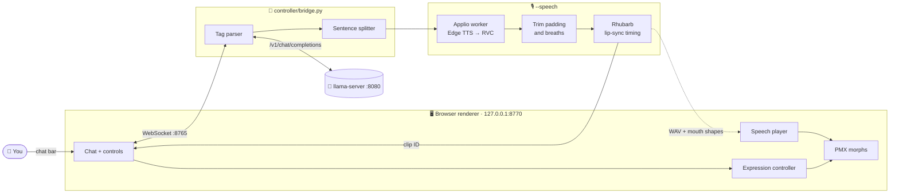
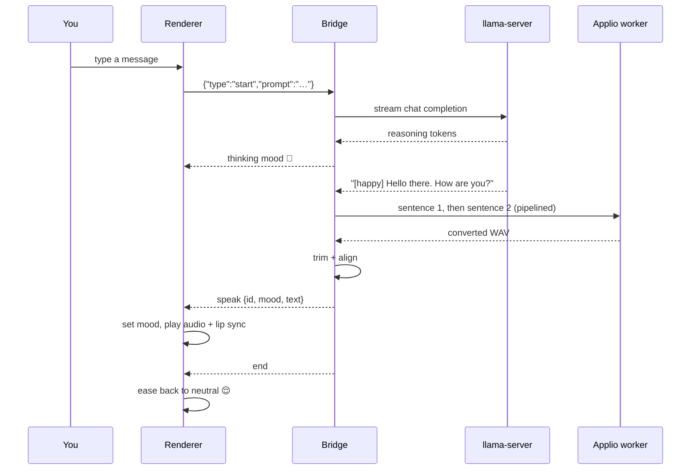

# 🌸 avatar-yidhari

A local virtual avatar for **Yidhari**: a PMX model in the browser that talks with a local LLM, shows moods on her face, and speaks in her own voice with lip sync. Built for Ubuntu 24.04 on an AMD Ryzen AI MAX+ 395 (Strix Halo).

This is a companion project, kept outside `my_code_pc` so it does not compete for workspace space.

## ✨ What she can do

- 💬 **Chat:** type into the chat bar; replies stream from a local `llama-server`.
- 😊 **Moods:** the LLM adds tags such as `[soft-smile:0.6]`, which become facial expressions from a catalog of 46 presets.
- 🤔 **Thinking face:** while the model reasons, she looks thoughtful.
- 🎙️ **Voice:** each sentence is spoken with Edge TTS, then converted to Yidhari's voice with an Applio RVC model.
- 👄 **Lip sync:** Rhubarb Lip Sync times mouth shapes from the final audio, and the renderer plays them on the audio clock.
- 👀 **Idle life and tuning:** automatic blinking, plus wink controls and a morph test bench for tuning expressions.

## 🧭 How it works



The LLM only supplies text and mood tags. Mouth timing is measured from the final audio, never invented by the LLM. Only a generated clip ID crosses the WebSocket; the browser loads the files from the local server.

### 🗣️ One spoken reply



## 🧰 Requirements

| Needed for | What | Notes |
| --- | --- | --- |
| Everything | Python 3.10+ | Bridge and renderer server |
| Everything | Chrome or another modern browser | Loads Three.js from a CDN |
| Everything | `yidhari-mmd/伊德海莉.pmx` | Local model pack, gitignored; its readme forbids redistribution |
| Chat | `llama-server` (llama.cpp) on `127.0.0.1:8080` | Any OpenAI-compatible server should work |
| 🎙️ Voice | [Applio](https://github.com/IAHispano/Applio) 3.6.6 at `../Applio` with its own `.venv` and the Yidhari voice model | Kept separate from this repo's environment |
| 🎙️ Voice | [Rhubarb Lip Sync](https://github.com/DanielSWolf/rhubarb-lip-sync/releases) 1.14.0 and `ffmpeg` on `PATH` | Rhubarb aligns mouth shapes; ffmpeg decodes audio |
| 🎙️ Voice | Internet access | Edge TTS is an online service; your text is sent to it |

## 🚀 Quick start

1. **Set up the Python environment** (once):

   ```bash
   python3 -m venv .venv
   .venv/bin/python -m pip install -r requirements.txt
   ```

2. **Start the renderer server** (leave it running):

   ```bash
   .venv/bin/python renderer/serve.py
   ```

3. **Start the bridge in demo mode** in a second terminal; no LLM needed:

   ```bash
   .venv/bin/python controller/bridge.py --mode demo
   ```

4. **Open [http://127.0.0.1:8770/renderer/](http://127.0.0.1:8770/renderer/).** Use `127.0.0.1`, not `localhost`, and do not open the HTML file directly. Wait for **Connected · ready**, then click **Start default response**. She smiles, thinks, and returns to neutral.

## 🤖 Talk to the local LLM

Start `llama-server` with your model on port 8080, for example:

```bash
llama-server -m /path/to/model.gguf --host 127.0.0.1 --port 8080
```

Then restart the bridge in LLM mode (Ctrl+C the demo first):

```bash
.venv/bin/python controller/bridge.py --mode llm
```

Type into the chat bar above her portrait and press **Send**. Each message is a fresh single-turn request; there is no chat history yet.

## 🎙️ Voice and lip sync

1. **Install the tools:**

   ```bash
   sudo apt install ffmpeg
   # Rhubarb: download Rhubarb-Lip-Sync-1.14.0-Linux.zip from its releases page, then
   unzip Rhubarb-Lip-Sync-1.14.0-Linux.zip -d ~/.local/opt/
   ln -s ~/.local/opt/Rhubarb-Lip-Sync-1.14.0-Linux/rhubarb ~/.local/bin/rhubarb
   rhubarb --version
   ```

2. **Check Applio:** it should be installed next to this repository at `../Applio`, with `.venv/bin/python` and the voice model under `logs/Yidhari-zzz/`.

3. **Start the bridge with speech:**

   ```bash
   .venv/bin/python controller/bridge.py --mode llm --speech
   ```

   Wait for `Applio worker ready…` (about 4 seconds), then chat as usual. She speaks each sentence as soon as it is ready, with her mouth following the audio.

The voice model and Applio settings (Edge voice, speed, pitch, index rate, protect) are in `ApplioSettings` in [controller/speech.py](controller/speech.py). Use `--pth /path/to/model.pth` to try another voice model. Applio's own log goes to `assets/private/speech/applio-worker.log`.

### 🎛️ Bridge options

| Option | Default | Meaning |
| --- | --- | --- |
| `--mode` | `demo` | `demo` plays a fixed reply; `llm` talks to `llama-server` |
| `--speech` | off | Speak replies with Applio and lip sync |
| `--pth` | `Yidhari-zzz_75e_21450s.pth` | Applio voice model |
| `--llama-url` | `http://127.0.0.1:8080` | LLM server base URL |
| `--model` | none | Model alias, if the server needs one |
| `--prompt` | a greeting | Prompt for **Start default response** |
| `--port` | `8765` | Bridge WebSocket port |

## 🧪 Tests

```bash
.venv/bin/python -m unittest discover -s tests -v   # bridge, speech pipeline, trimming, alignment
node --test tests/renderer/                          # renderer speech session
```

No packages are needed for the renderer tests; they use Node's built-in test runner.

## 📁 Layout

```text
avatar-yidhari/
  README.md
  requirements.txt
  controller/          # 🐍 LLM bridge, speech pipeline, Applio worker, trimming, alignment
  renderer/            # 🖥️ browser PMX viewer, chat, expressions, speech player
  tests/               # 🧪 Python tests, plus tests/renderer/ for Node
  docs/                # 📚 architecture notes and guides
  assets/private/      # 🔒 gitignored: speech samples and live clips
  yidhari-mmd/         # 🔒 gitignored: local PMX model pack
```

## 📚 Docs

| Doc | What's inside |
| --- | --- |
| [architecture-v2.md](docs/architecture-v2.md) | Design, pipeline details, measurements and TODOs |
| [running-the-bridge.md](docs/running-the-bridge.md) | Full bridge guide and troubleshooting |
| [pmx-morph-catalog.md](docs/pmx-morph-catalog.md) | Every PMX facial morph |
| [shared-expression-catalog.md](docs/shared-expression-catalog.md) | Mood presets used by the LLM |
| [issue-labels.md](docs/issue-labels.md) | Issue priority, difficulty and emoji labels |

The plan for upcoming features is in the [🗺️ roadmap issue #21](https://github.com/arctic-cheetah/AI-Avatar-PMX-MMD/issues/21).

## 🔒 Privacy and safety

- The bridge listens only on `127.0.0.1` and accepts only the renderer's origin.
- LLM output is treated as untrusted: only catalog mood names are accepted, and text is shown as plain text.
- With `--speech`, each sentence is sent to Edge TTS online. Chat without `--speech` stays on your machine.

## 🖥️ Hardware notes

- Chip: AMD Ryzen AI MAX+ 395 (Strix Halo)
- Memory: soldered LPDDR5X-8000, 256-bit bus
- Peak bandwidth: 256 GB/s theoretical
- Unified memory shared by CPU, RDNA 3.5 iGPU, and XDNA 2 NPU
- Constraint to watch: iGPU compute contention, not memory bandwidth

## 🧑‍💻 Editor

The page loads Three.js from a CDN. For VS Code hover and completion, install the matching local package:

```bash
npm install
```

`jsconfig.json` points the JavaScript language service at `renderer/`. `node_modules/` is gitignored.

## 📜 License

Copyright © 2026 arctic-cheetah

This program is free software: you can redistribute it and/or modify it under the terms of the **GNU Lesser General Public License** as published by the Free Software Foundation, either version 3 of the License, or (at your option) any later version.

This program is distributed in the hope that it will be useful, but WITHOUT ANY WARRANTY; without even the implied warranty of MERCHANTABILITY or FITNESS FOR A PARTICULAR PURPOSE. See the [GNU Lesser General Public License](https://www.gnu.org/licenses/lgpl-3.0.html) for more details. The LGPLv3 builds on the [GNU General Public License v3](https://www.gnu.org/licenses/gpl-3.0.html).

SPDX identifier: `LGPL-3.0-or-later`

**Not covered by this license:** the Yidhari PMX model pack (`yidhari-mmd/`, third-party, gitignored, and not redistributable), voice models and audio, and external tools used alongside this project (Applio, Rhubarb Lip Sync, Edge TTS, llama.cpp and Three.js), which keep their own licenses and terms.
