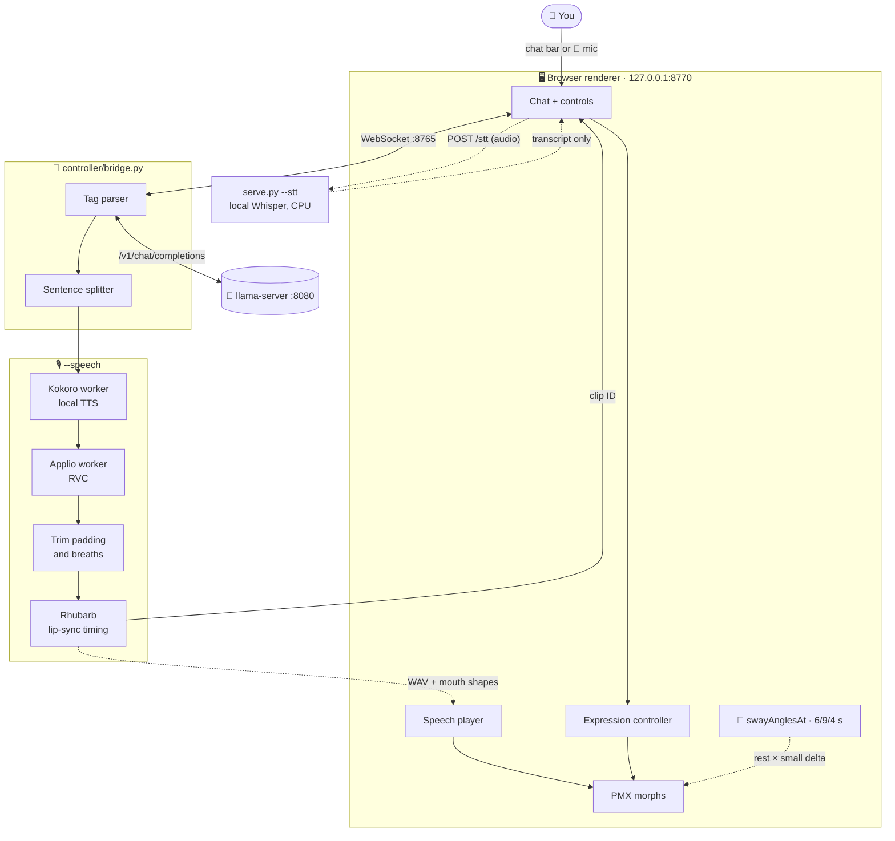
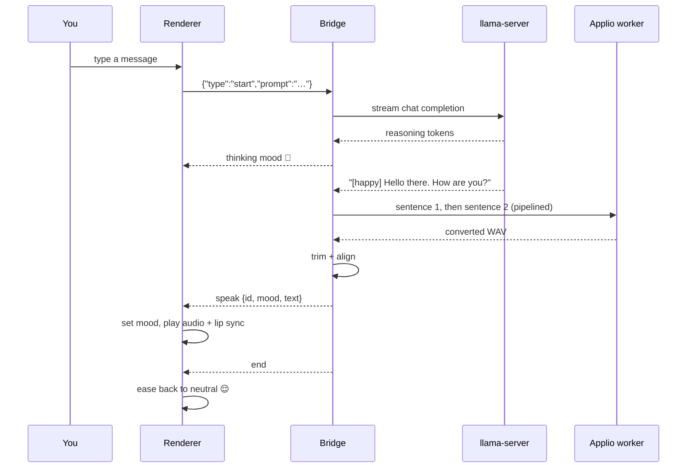

# 🌸 avatar-yidhari

A local virtual avatar for **Yidhari**: a PMX model in the browser that talks with a local LLM, shows moods on her face, and speaks in her own voice with lip sync. Built for Ubuntu 24.04 on an AMD Ryzen AI MAX+ 395 (Strix Halo).

This is a companion project, kept outside `my_code_pc` so it does not compete for workspace space.

## ✨ What she can do

- 💬 **Chat:** type into the chat bar; replies stream from a local `llama-server`.
- 🤖 **Agent voice:** start the bridge with `--agent` and a coding agent such as Claude Code can make her speak (`say`) and change her face (`set_mood`) through a small MCP server — see [docs/agent-voice.md](docs/agent-voice.md).
- 🎤 **Voice input:** click **🎤 Talk**, speak, click **■ Stop**. Local Whisper on the CPU turns it into a chat prompt; audio never leaves the machine ([docs/voice-input.md](docs/voice-input.md)).
- 😊 **Moods:** the LLM adds tags such as `[soft-smile:0.6]`, which become facial expressions from a catalog of 46 presets.
- 🤔 **Thinking face:** while the model reasons, she looks thoughtful.
- 🎙️ **Voice:** each sentence is synthesised locally with Kokoro TTS (`--tts kokoro`), then converted to Yidhari's voice with an Applio RVC model. Edge TTS is still available with `--tts edge`.
- 👄 **Lip sync:** Rhubarb Lip Sync times mouth shapes from the final audio, and the renderer plays them on the audio clock.
- 👀 **Idle life and tuning:** automatic blinking, plus wink controls and a morph test bench for tuning expressions.
- 🌊 **Slow sway:** her upper body drifts on gentle sine waves with a breathing motion, and settles back to still when toggled off — see [docs/body-sway.md](docs/body-sway.md).
- 👁️ **Gaze tracking:** her eyes (and gently, her head) follow your mouse cursor and/or your face on webcam — see [docs/gaze-tracking.md](docs/gaze-tracking.md). The webcam only starts when you toggle it on, and frames never leave the browser.

## 🧭 How it works



The LLM only supplies text and mood tags. Mouth timing is measured from the final audio, never invented by the LLM. Only a generated clip ID crosses the WebSocket; the browser loads the files from the local server.

### 🗣️ One spoken reply



## 🧰 Requirements

| Needed for         | What                                                                                                                   | Notes                                                                                                                                                                                               |
| ------------------ | ---------------------------------------------------------------------------------------------------------------------- | --------------------------------------------------------------------------------------------------------------------------------------------------------------------------------------------------- |
| Everything         | Python 3.10+                                                                                                           | Bridge and renderer server                                                                                                                                                                          |
| Everything         | Chrome or another modern browser                                                                                       | Loads Three.js from a CDN                                                                                                                                                                           |
| Everything         | `yidhari-mmd/伊德海莉.pmx`                                                                                           | Local model pack, gitignored; its readme forbids redistribution                                                                                                                                     |
| Chat               | `llama-server` (llama.cpp) on `127.0.0.1:8080`                                                                     | Any OpenAI-compatible server should work                                                                                                                                                            |
| 🎙️ Voice         | Kokoro local TTS                                                                                                       | Installed by `python3 -m controller.setup_kokoro`; runs in `.venv-kokoro` and stores models under `models/kokoro/`                                                                            |
| 🎙️ Voice         | [Applio](https://github.com/IAHispano/Applio) 3.6.6 at `../Applio` with its own `.venv` and the Yidhari voice model | Kept separate from this repo's environment. Use `../Applio-rocm` with `--applio-dir` for ROCm GPU RVC — full GPU setup for AMD ROCm **and** NVIDIA CUDA in [docs/setup.md](docs/setup.md) |
| 🎙️ Voice         | [Rhubarb Lip Sync](https://github.com/DanielSWolf/rhubarb-lip-sync/releases) 1.14.0 and `ffmpeg` on `PATH`          | Rhubarb aligns mouth shapes; ffmpeg decodes audio                                                                                                                                                   |
| 🎤 Voice input     | faster-whisper in `.venv-stt` and a microphone                                                                       | Installed by `python3 -m controller.setup_stt`; models in `models/whisper/`; enabled with `renderer/serve.py --stt`                                                                           |
| 🎙️ Edge fallback | Internet access                                                                                                        | Only needed for `--tts edge`; Edge TTS is online and receives the spoken text                                                                                                                     |

## 🚀 Quick start

1. **Set up the Python environment and Kokoro** (once). The Kokoro setup downloads its local model and voice assets, then speech can run without sending text to an online TTS service:

   ```bash
   python3 -m venv .venv
   .venv/bin/python -m pip install -r requirements.txt
   python3 -m controller.setup_kokoro
   ```
2. **Start the renderer server** (leave it running):

   ```bash
   .venv/bin/python renderer/serve.py
   ```
3. **Start the bridge in demo mode** in a second terminal; no LLM needed:

   ```bash
   .venv/bin/python controller/bridge.py --mode demo
   ```
4. **Open [http://127.0.0.1:8770/renderer/](http://127.0.0.1:8770/renderer/).** Use `127.0.0.1`, not `localhost`, and do not open the HTML file directly. Wait for **Connected · ready**, then click **Start default response**. She smiles, thinks, and returns to neutral.

## 🤖 Talk to the local LLM

Start `llama-server` with your model on port 8080, for example:

```bash
llama-server -m /path/to/model.gguf --host 127.0.0.1 --port 8080
```

Then restart the bridge in LLM mode (Ctrl+C the demo first):

```bash
.venv/bin/python controller/bridge.py --mode llm
```

Type into the chat bar above her portrait and press **Send**. She remembers earlier turns of the current chat, trimmed to fit the model's context window. Press **New chat** to start over; a reconnect also starts fresh. Details are in [docs/conversation-history.md](docs/conversation-history.md).

Any other OpenAI-compatible server works too — local Ollama / LM Studio, or a cloud or proxy endpoint (OpenAI, OpenRouter, EasyProxy / CLIProxyAPI) with `--llama-url <base>`, `--model <name>` and a key from an environment variable:

```bash
export OPENAI_API_KEY='sk-…'   # bridge only; never sent to the browser
.venv/bin/python controller/bridge.py --mode llm \
  --llama-url https://your-proxy.example/v1 --model your-model-name \
  --context-tokens 65536
```

⚠️ With a non-loopback URL your chat text leaves this machine for that provider. Full options (`--api-key-env`, `--llm-header`, `--allow-no-key`), URL forms, provider examples and troubleshooting are in [docs/external-llm.md](docs/external-llm.md).

## 🎤 Talk to her (voice input)

1. **Install** (once): `python3 -m controller.setup_stt`. This creates `.venv-stt` and downloads Whisper `base.en` at a pinned revision.
2. **Start the renderer server with STT:** `.venv/bin/python renderer/serve.py --stt` (instead of plain `serve.py`).
3. Start the bridge as usual, open the page, click **🎤 Talk** and allow the microphone. Click **■ Stop** when you finish speaking.

The transcript shows up as your chat bubble and goes down the same `{"type":"start","prompt":…}` path as typed chat. The mic is disabled while she is busy, and typing always keeps working. Measurements, options (`--stt-model`, `--stt-threads`), security notes and troubleshooting are in [docs/voice-input.md](docs/voice-input.md).

## 🎙️ Voice and lip sync

1. **Install the tools:**

   ```bash
   sudo apt install ffmpeg
   # Rhubarb: download Rhubarb-Lip-Sync-1.14.0-Linux.zip from its releases page, then
   unzip Rhubarb-Lip-Sync-1.14.0-Linux.zip -d ~/.local/opt/
   ln -s ~/.local/opt/Rhubarb-Lip-Sync-1.14.0-Linux/rhubarb ~/.local/bin/rhubarb
   rhubarb --version
   ```
2. **Install Kokoro (default voice source):**

   ```bash
   python3 -m controller.setup_kokoro
   ```

   This creates `.venv-kokoro` and downloads the Kokoro model and voices into `models/kokoro/`. After setup, Kokoro synthesis runs locally and does not send speech text online.
3. **Check Applio:** it should be installed next to this repository at `../Applio`, with `.venv/bin/python` and the voice model under `logs/Yidhari-zzz/`. For GPU conversion, follow [docs/setup.md](docs/setup.md): **AMD ROCm** uses the separate `../Applio-rocm` install (`--applio-dir ../Applio-rocm`), while **NVIDIA CUDA** uses the standard `../Applio` install.
4. **Start the bridge with Kokoro speech (recommended default command):**

   ```bash
   .venv/bin/python controller/bridge.py --mode llm --speech \
     --tts kokoro --kokoro-voice af_heart --kokoro-speed 1.0 --kokoro-threads 2 \
     --applio-dir "../Applio-rocm"
   ```

   If you do not have `../Applio-rocm`, omit `--applio-dir` to use the CPU Applio install at `../Applio` (and optionally add `--rvc-threads 4`). Wait for `Applio worker ready…`, then chat as usual. She speaks each sentence as soon as it is ready, with her mouth following the audio.
5. **Edge fallback (optional):** to compare against the online Edge source instead, start with `--tts edge`:

   ```bash
   .venv/bin/python controller/bridge.py --mode llm --speech --tts edge
   ```

The voice model and Applio settings (RVC pitch, index rate, protect, plus Kokoro voice/speed/threads) are in `ApplioSettings` in [controller/speech.py](controller/speech.py). Use `--pth /path/to/model.pth` and `--index /path/to/model.index` to try another voice model. Kokoro's log goes to `assets/private/speech/kokoro-worker.log`; Applio's own log goes to `assets/private/speech/applio-worker.log`.

### 🎛️ Bridge options

| Option               | Default                               | Meaning                                                                        |
| -------------------- | ------------------------------------- | ------------------------------------------------------------------------------ |
| `--mode`           | `demo`                              | `demo` plays a fixed reply; `llm` talks to `llama-server`                |
| `--speech`         | off                                   | Speak replies with TTS → RVC and lip sync                                     |
| `--tts`            | `edge` in code; docs use `kokoro` | TTS source. **README's recommended default is `--tts kokoro`** (local) |
| `--kokoro-voice`   | `af_heart`                          | Kokoro voice ID                                                                |
| `--kokoro-speed`   | `1.0`                               | Kokoro speed multiplier                                                        |
| `--kokoro-threads` | `2`                                 | CPU ONNX threads for the Kokoro worker                                         |
| `--applio-dir`     | `../Applio`                         | Applio install to launch; `../Applio-rocm` enables ROCm GPU RVC              |
| `--pth`            | model under `--applio-dir`          | Applio voice model                                                             |
| `--index`          | index under `--applio-dir`          | Applio voice index                                                             |
| `--rvc-threads`    | `0` (PyTorch default)               | CPU RVC threads; mainly for the CPU Applio path                                |
| `--llama-url`      | `http://127.0.0.1:8080`             | Any OpenAI-compatible base URL (or full `…/chat/completions` endpoint); cloud/proxy URLs send chat text off-machine |
| `--model`          | none                                  | Model name/id; required for non-loopback URLs                                  |
| `--api-key-env`    | `OPENAI_API_KEY`                    | Env var holding the upstream API key (bridge only, sent as Bearer)             |
| `--llm-header`     | none                                  | Extra upstream header `Name: Value`; repeatable (never `Authorization`)         |
| `--allow-no-key`   | off                                   | Allow a non-loopback URL with no API key (keyless proxies only)                |
| `--context-tokens` | `/props` or 65536                     | Model context window; pass it for non-loopback servers (not probed)            |
| `--prompt`         | a greeting                            | Prompt for **Start default response**                                    |
| `--port`           | `8765`                              | Bridge WebSocket port                                                          |

### 🚩 CLI flags added / expanded

### Bridge flags

| Flag                    | Purpose                                                                                                                                                                                |
| ----------------------- | -------------------------------------------------------------------------------------------------------------------------------------------------------------------------------------- |
| `--tts {edge,kokoro}` | Selects the TTS source. The bridge code defaults to `edge` for backwards compatibility, but the README's recommended speech command uses `--tts kokoro` for fully local synthesis. |
| `--kokoro-voice`      | Kokoro voice ID, e.g. `af_heart`.                                                                                                                                                    |
| `--kokoro-speed`      | Kokoro speaking speed multiplier. `1.0` is the baseline.                                                                                                                             |
| `--kokoro-threads`    | CPU ONNX thread count for the Kokoro worker.                                                                                                                                           |
| `--rvc-threads`       | PyTorch CPU thread count for RVC when using the CPU Applio path.                                                                                                                       |
| `--applio-dir`        | Applio installation to launch. Defaults to `../Applio`; use `../Applio-rocm` for ROCm GPU RVC.                                                                                     |
| `--pth`               | Explicit Applio voice model path. If omitted, the default Yidhari model under `--applio-dir` is used.                                                                                |
| `--index`             | Explicit Applio voice index path. If omitted, the default Yidhari index under `--applio-dir` is used.                                                                                |

### Kokoro worker / audition flags

| Flag              | Purpose                                                                    |
| ----------------- | -------------------------------------------------------------------------- |
| `--list-voices` | Lists available Kokoro voices.                                             |
| `--voice`       | Voice ID for standalone Kokoro or audition runs.                           |
| `--speed`       | Speed multiplier for standalone Kokoro or audition runs.                   |
| `--threads`     | CPU thread count for standalone Kokoro or audition runs.                   |
| `--text`        | Text to synthesise; can be repeated in audition mode for multiple samples. |
| `--output`      | Output WAV path for standalone Kokoro synthesis.                           |
| `--output-dir`  | Output directory for Kokoro → RVC audition clips and `results.json`.    |
| `--worker`      | Runs Kokoro as the persistent JSON-line worker used by the bridge.         |

## 🧪 Tests

```bash
.venv/bin/python -m unittest discover -s tests -v   # bridge, speech pipeline, trimming, alignment
node --test tests/renderer/                          # renderer speech session
```

No packages are needed for the renderer tests; they use Node's built-in test runner.

## 📁 Layout

```text
avatar-yidhari/
  README.md
  requirements.txt
  requirements-kokoro.txt
  requirements-stt.txt
  controller/          # 🐍 LLM bridge, speech pipeline, Kokoro/Applio/Whisper workers, trimming, alignment
  renderer/            # 🖥️ browser PMX viewer, chat, voice input, expressions, speech player
  tests/               # 🧪 Python tests, plus tests/renderer/ for Node
  docs/                # 📚 architecture notes and guides
  models/kokoro/       # 🔒 gitignored: downloaded Kokoro model and voices
  models/whisper/      # 🔒 gitignored: downloaded Whisper STT models
  assets/private/      # 🔒 gitignored: speech samples and live clips
  yidhari-mmd/         # 🔒 gitignored: local PMX model pack
```

## 📚 Docs

| Doc                                                              | What's inside                                           |
| ---------------------------------------------------------------- | ------------------------------------------------------- |
| [architecture-v2.md](docs/architecture-v2.md)                     | Design, pipeline details, measurements and TODOs        |
| [setup.md](docs/setup.md)                                         | Install Applio on GPU: AMD ROCm or NVIDIA CUDA          |
| [running-the-bridge.md](docs/running-the-bridge.md)               | Full bridge guide and troubleshooting                   |
| [testing-kokoro.md](docs/testing-kokoro.md)                       | Kokoro setup, audition commands and measurements        |
| [voice-input.md](docs/voice-input.md)                             | Mic → local Whisper STT: setup, measurements, security |
| [conversation-history.md](docs/conversation-history.md)           | Chat memory, context budget, New chat and reconnects   |
| [external-llm.md](docs/external-llm.md)                           | Cloud / proxy OpenAI-compatible LLMs, API keys, headers |
| [agent-voice.md](docs/agent-voice.md)                             | Coding agent → MCP → Yidhari speech (issue #27)         |
| [pmx-morph-catalog.md](docs/pmx-morph-catalog.md)                 | Every PMX facial morph                                  |
| [gaze-tracking.md](docs/gaze-tracking.md)                         | Cursor + webcam gaze tracking design (issue #6)         |
| [body-sway.md](docs/body-sway.md)                               | Slow sine-wave body sway design (issue #4)              |
| [shared-expression-catalog.md](docs/shared-expression-catalog.md) | Mood presets used by the LLM                            |
| [issue-labels.md](docs/issue-labels.md)                           | Issue priority, difficulty and emoji labels             |

The plan for upcoming features is in the [🗺️ roadmap issue #21](https://github.com/arctic-cheetah/AI-Avatar-PMX-MMD/issues/21).

## 🔒 Privacy and safety

- The bridge listens only on `127.0.0.1` and accepts only the renderer's origin.
- LLM output is treated as untrusted: only catalog mood names are accepted, and text is shown as plain text.
- Voice input is transcribed locally (`serve.py --stt`); `POST /stt` accepts only the renderer's own origin, recordings are deleted right after transcription, and no audio crosses the bridge WebSocket.
- With `--speech --tts kokoro`, speech text stays on your machine and is converted locally. With `--speech --tts edge`, each sentence is sent to Edge TTS online. Chat without `--speech` stays on your machine with a loopback `--llama-url`; a cloud/proxy URL sends prompts and history to that provider (see [docs/external-llm.md](docs/external-llm.md)). API keys live only in the bridge's environment, never in the browser or repo.
- With `--agent`, only processes running as your user can reach the agent socket (mode 0700 directory, peer uid checked). Agent text is untrusted input: it is capped, stripped of control characters and rate limited.

## 🖥️ Hardware notes

- Chip: AMD Ryzen AI MAX+ 395 (Strix Halo)
- Memory: soldered LPDDR5X-8000, 256-bit bus
- Peak bandwidth: 256 GB/s theoretical
- Unified memory shared by CPU, RDNA 3.5 iGPU, and XDNA 2 NPU
- Constraint to watch: iGPU compute contention, not memory bandwidth

## 🧑‍💻 Editor

The page loads Three.js from a CDN. For VS Code hover and completion, install the matching local package:

```bash
npm install
```

`jsconfig.json` points the JavaScript language service at `renderer/`. `node_modules/` is gitignored.

## 📜 License

Copyright © 2026 arctic-cheetah

This program is free software: you can redistribute it and/or modify it under the terms of the **GNU Lesser General Public License** as published by the Free Software Foundation, either version 3 of the License, or (at your option) any later version.

This program is distributed in the hope that it will be useful, but WITHOUT ANY WARRANTY; without even the implied warranty of MERCHANTABILITY or FITNESS FOR A PARTICULAR PURPOSE. See the [GNU Lesser General Public License](https://www.gnu.org/licenses/lgpl-3.0.html) for more details. The LGPLv3 builds on the [GNU General Public License v3](https://www.gnu.org/licenses/gpl-3.0.html).

SPDX identifier: `LGPL-3.0-or-later`

**Not covered by this license:** the Yidhari PMX model pack (`yidhari-mmd/`, third-party, gitignored, and not redistributable), voice models and audio, and external tools used alongside this project (Applio, Rhubarb Lip Sync, Edge TTS, llama.cpp and Three.js), which keep their own licenses and terms.
