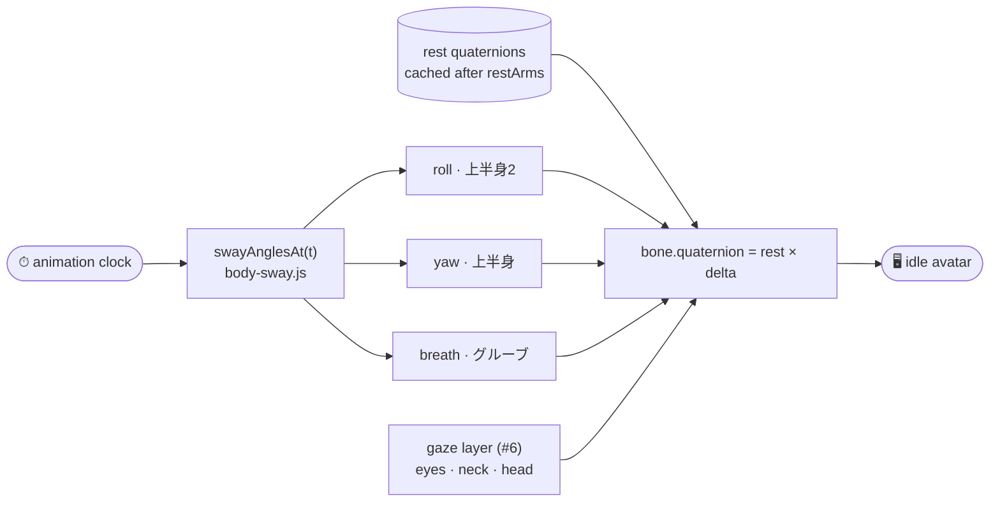
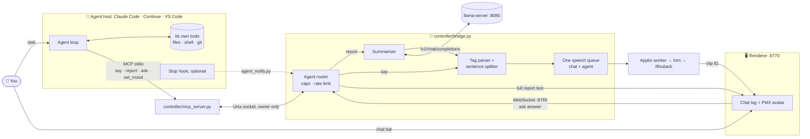
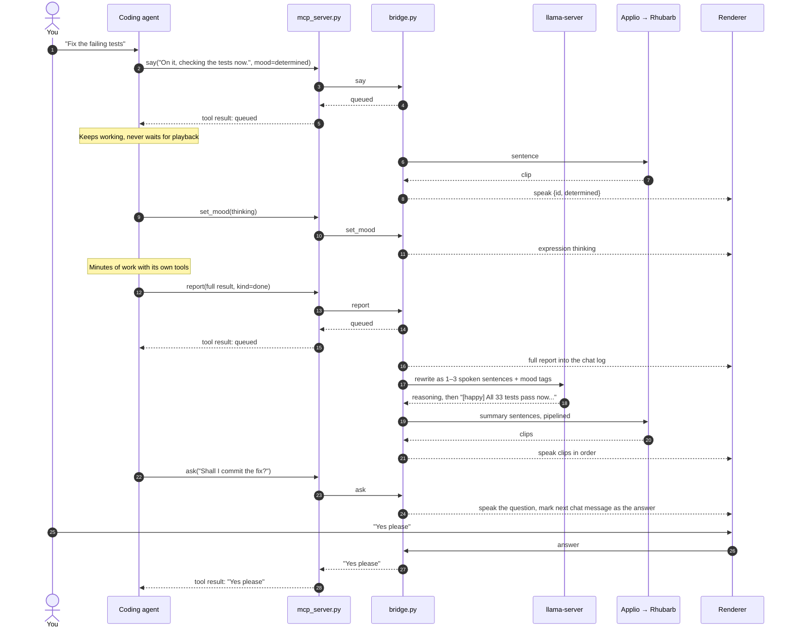

# Architecture v2 — PMX companion

Target host: user-reported ASUS ProArt PX13, Ryzen AI MAX+ 395, 128 GB unified memory, Ubuntu 24.04.

This supersedes the VRM/Live2D sketch in [architecture.md](./architecture.md).
Reconstructed from the conversation after repository loss on 2026-10-17;
see [Restoration status](./restoration-status.md) for current recovery limits.

## Goal

A quiet companion, not a dancer. The face combines blink, semantic moods, and
accurate sound-by-sound lip sync. Small canned hand poses are planned. The body
stays mostly stationary; no dance VMD or locomotion is required. Existing arm
lowering is a local pose adjustment. Hair/coat/tail physics remain future work.

Speech uses timed phonemes mapped to calibrated visemes, including consonant
closures and silence. Five vowel shapes or a loudness-driven mouth alone are not
the finished target. TTS determines audible pronunciation; animation follows it.

## Loop

Local TTS on `ticket-21-kokoro-local-tts`: `--tts kokoro` selects a persistent
CPU ONNX Kokoro worker (`controller/kokoro_worker.py`, isolated `.venv-kokoro`,
`kokoro-onnx` 0.6.1, `af_heart` default) instead of Edge, then feeds a source
WAV to the existing RVC, trim and final-audio alignment path. Edge remains the
default. Kokoro mode never falls back to Edge or sends speech text to an online
service, which closes the offline/private exposure noted under Security below.
User listening verdict (22 Oct 2026): Kokoro → RVC sounds noticeably more
believable than Edge → RVC. See [Testing Kokoro locally](./testing-kokoro.md)
for setup, commands and measurements. RVC itself can run on the AMD GPU via
`--applio-dir ../Applio-rocm` (ROCm PyTorch, Radeon 8060S/gfx1151); measured
2026-10-23 below and in [the bridge guide](./running-the-bridge.md).

```text
User text -> llama-server (Qwen, Vulkan, 127.0.0.1:8080)
                    |
             streaming text + mood tags
                    v
             controller/bridge.py
                    |
                    +-- Text preview: clean text + expression events
                    |
                    +-- Speech (bridge --speech; per sentence, pipelined):
                        source TTS (per --tts):
                          edge   -> Edge TTS (online; default)
                          kokoro -> controller/kokoro_worker.py (CPU ONNX, local)
                        persistent Applio worker (controller/applio_worker.py;
                        --applio-dir selects ../Applio CPU or ../Applio-rocm GPU):
                          source audio -> RVC (one conversion at a time, in order)
                          -> controller/speech_trim.py (cut padding and tail breaths)
                          -> final WAV + exact transcript
                          -> controller/speech_align.py (Rhubarb Lip Sync)
                          -> .visemes.json (timed mouth shapes) + segment mood
                    |
             WebSocket 127.0.0.1:8765
                    v
             renderer/bridge-client.js -> renderer/main.js
                    |
             expression controller (mood) -> speech-player.js (audio clock,
             blends speech-shapes.json over the mood mouth)
                    v
             PMX morph weights -> screen / OBS
```

The LLM supplies only text and mood tags. Phoneme and mouth timing is measured
from the final audio by a deterministic aligner, never generated by the LLM or
routed through an MCP tool call (see the lip-sync tooling notes below).

Applio replaces the earlier VCClient candidate for voice conversion. Applio 3.6.6
is installed at `/home/parrot/Code/Applio` with the user's trained Yidhari voice
model ported from the earlier RTX 4090 build. User-reported: its UI TTS produced a
10.66 s clip in about 3 s (real-time factor ≈ 0.3). Since 2026-10-23 a second
sibling install, `/home/parrot/Code/Applio-rocm`, carries a ROCm PyTorch build
(`torch 2.11.0+rocm7.2`) that runs RVC on the Radeon 8060S; the bridge selects
between them with `--applio-dir`, and the Yidhari `.pth`/`.index` defaults follow
the chosen install (details in "Kokoro source TTS and ROCm RVC" below). Conversion
can be bypassed for baseline comparisons. Keep each Applio as a sibling
installation with its own Python environment and voice models; configure an
explicit path when integrating it. Do not mix its dependencies into the avatar
environment.

Applio's [TTS documentation](https://docs.applio.org/getting-started/tts/) describes
Edge TTS followed by optional RVC conversion. **Edge TTS is the chosen primary
source** for now; it sends text to an online service. The local alternative is no
longer only planned: `--tts kokoro` runs Kokoro-82M on CPU ONNX (isolated
`.venv-kokoro`) into the same RVC model; Piper remains an unbenchmarked candidate
(#18). Initial integration uses a saved final WAV, not live virtual-device routing.
Applio provides no phoneme timings; alignment runs on its output.

The renderer runs separately from inference. This prevents blocking animation
with inference work, but does not eliminate contention for shared hardware.

## Model and runtime

Load `yidhari-mmd/伊德海莉.pmx` without moving or renaming the model pack: texture
paths are relative. Keep the pack gitignored; its readme forbids redistribution.
Do not load `武器.pmx`. The pack contains no dance motion, and none is needed.

The [PMX catalog](./pmx-morph-catalog.md) inventories 56 vertex morphs. Blink uses
`まばたき`; winks use `ウィンク` and `ウィンク右`. The
[shared JSON catalog](../renderer/expressions.json) holds 46 semantic presets,
including `neutral` with an empty morph map. Presets are interpreted visually,
not inferred reliably from duplicated English metadata labels.

Preview buttons and bridge callbacks call the same expression controller. One
mood is active at a time, with easing to another mood or neutral. The controller
resolves required morphs and disables unavailable presets. Loop intensity is
retained across presets; the intensity slider can rescale the active mood or
loop without stopping it. The test bench provides manual sliders, a sweep,
candidate storage, and JSON export; these are authoring tools, not LLM controls.

Every frame resets morph influences, then applies blink, winks, mood and manual
audition contributions. Known overlap: `super-angry` uses the blink morph, and
seven moods (`cry`, `embarrassed`, `lovestruck`, `confused`, `nervous`,
`flustered`, `pleading`) use `あ` at 0.1–0.25. The speech player now writes after
the mood and blends each speech-owned morph from the mood value toward its own
shape, so closures override those moods. Mood mouth morphs outside the speech
catalog (for example `口角下げ`) still add on top unattenuated; a fuller
compositor with per-shape rules remains to do. Channel independence is not a
guarantee of non-conflicting geometry.

The thinking mood adds an eased chin-rest gesture: curled right fingers beneath
the chin, elbow lowered, and the left arm crossing underneath to support it,
plus a thought bubble and an upward eye offset (not a head tilt). The static
pose is solved from shoulder/elbow/wrist positions with a two-segment arm solver,
including intervening twist bones; finger curls are cached before restoring the
exact rest rotations. Targets are tuned for Yidhari's PMX proportions, not a
general-purpose retargeter. Both wrist targets and the raised elbow are spaced
forward to keep fingers/gloves outside the face and outfit. Head/neck and eye
tracking remain active at their normal limits throughout the gesture. The hand
target remains fixed relative to the torso rather than following the head.
Sway moves the pose with the torso. This is tuned clearance, not general mesh collision physics;
new model proportions or animations need another clearance check.
Missing optional bones are skipped. Gesture and bubble follow the active mood
each frame, including expression-loop transitions, and release at zero intensity
or on leaving thinking. Other hand poses (`rest`, `loose`, `lift`) remain planned.
Webcam tracking and full-body locomotion are out of scope.

With bridge `--speech --thinking-filler`, one fixed “Hmm…” clip is synthesised,
trimmed and aligned once at startup under `assets/private/speech/filler/`. The
first reasoning delta of a reply announces its cached ID; the renderer inserts
it ahead of the first answer clip in the serial speech queue. This makes the
filler one-shot and non-overlapping. It is opt-in because the words are not LLM
output, and preparation failure falls back to the silent thinking gesture.

### Body sway (issue #4)

The torso drifts on three slow sine channels so she feels alive while idle —
roll on `上半身2` (1.5°, 6 s), yaw on `上半身` (1.0°, 9 s), and a breathing
pitch on `グルーブ` (0.8°, 4 s). Periods are co-prime-ish, so the sum never
reads as a rigid loop, and they stay clear of the ~3 s expression loop.



Composition rule, shared with the gaze layer: `setupSway()` caches each bone's
rest quaternion at load (after `restArms()` drops the arms), and `applySway()`
multiplies a small YXZ delta on top every frame — sway never overwrites a
load-time pose. The pure math lives in `renderer/body-sway.js` with no DOM or
Three.js imports (mirroring `gaze-tracking.js`), covered by
`tests/renderer/body-sway.test.mjs`; a `Slow sway · ゆらぎ` toggle (default ON)
eases the bones back to rest when cleared. Amplitudes stay at a few degrees
because hair and coat have no physics yet — see [body-sway.md](./body-sway.md).

## Current state and historical verification

| Piece                                           | State after this restoration                                                                                           |
| ----------------------------------------------- | ---------------------------------------------------------------------------------------------------------------------- |
| JSON catalog, expression controller, test bench | Restored in the renderer                                                                                               |
| Browser WebSocket client and transcript         | Restored; waits for backend                                                                                            |
| Python bridge and llama-server adapter          | Restored: catalog parser, Origin-restricted WebSocket, SSE adapter, local environment and regression tests             |
| Live LLM test                                   | Post-repair backend test passed: qwen3.8-27b streamed soft-smile, thinking, neutral and tag-free text via WebSocket    |
| Applio + Edge TTS                               | User-reported working in the Applio UI (10.66 s clip in ~3 s); not yet automated from the bridge                       |
| Alignment                                       | Rhubarb Lip Sync 1.14.0 via `controller/speech_align.py`, with cue-validation tests                                  |
| Lip sync                                        | Saved-sample speech test, user-confirmed on screen                                                                     |
| Live LLM speech                                 | First version with `bridge --speech`: run end to end against qwen3.8-27b; renderer queue verified in headless Chrome |
| Kokoro local TTS                                | Implemented 2026-10-22 (`--tts kokoro`, CPU ONNX); we-confirmed more believable than Edge after RVC                   |
| ROCm RVC (Applio-rocm)                          | Implemented 2026-10-23 (`--applio-dir ../Applio-rocm`); E2E-verified; user-benchmarked faster under live LLM load       |

## LLM mood pipeline and events

The LLM gets only allowed semantic names and descriptions, never PMX names or
weights. The bridge reads the same UTF-8 JSON via a path relative to its source.
Example target output:

```text
[soft-smile:0.6] Good morning. [thinking:0.5] Let me think about that. [neutral]
```

The restored backend sends:

```json
{"type":"start"}
{"type":"expression","name":"soft-smile","weight":0.6}
{"type":"say","text":"Good morning."}
{"type":"end"}
```

`error` carries a text message. The renderer's chat bar (top of the portrait)
sends the user's message as a `start` request carrying a prompt:

```json
{"type":"start","prompt":"Hello Yidhari!"}
```

A bare `{"type":"start"}` (the "Start default response" button) uses the CLI
`--prompt` default. Prompts are validated before any generation starts — a bad
request is dropped without cancelling a running response — and are limited to
4,000 characters inside a 128 KiB socket frame. Each connection keeps its own
conversation history, trimmed to the context budget; `{"type":"reset"}` clears
it (see [conversation-history.md](conversation-history.md)). Replies stream
into the chat log as user/avatar bubbles written with `textContent`.

Each run begins neutral; in text-only mode,
successful completion keeps the last mood unless a neutral tag was emitted. In
speech mode the renderer eases to neutral 0.6 s after the last clip of a finished
response stops ([speech-session.js](../renderer/speech-session.js)), and the
bridge sends neutral if a response produced no clips, so the thinking face never
sticks. Generation errors reset neutral. The browser preserves the last mood on disconnect. The renderer writes transcript text with `textContent`, limits retained
text to 50,000 characters, reconnects without automatically repeating a run,
and clears manual overrides/stops the loop on start. Authoring controls are
inert while receiving a response.

The streaming parser must retain split tags such as `[soft-` + `smile:0.6]`.
Case-sensitive catalog names are allowlisted; decimal intensity defaults to 1,
finite values clamp to 0–1. Brackets are reserved controls: unknown, malformed,
oversized (over 128 characters), and unfinished blocks are dropped. Text outside
tags preserves whitespace. Consequently general Markdown links, bracketed
citations and code indexing require a different structured-control protocol.

The restored llama-server adapter posts streamed `/v1/chat/completions` requests,
uses content deltas rather than reasoning deltas, and generates its system
prompt from the catalog. Every request — from the chat bar or from the CLI
prompt default — is sent with the connection's earlier completed turns;
nothing persists across reconnects. Text preview changes expression on arrival; final
speech must change it at audio playback start.

## Speech and expression synchronisation

Steps 1, 2 and 5 work for one saved sample; queues, cancellation across
segments and live bridge integration are not implemented. Multiple phonemes
can share a viseme. Do not assign mouth shapes from spelling or equal-duration
syllables, and do not ask the LLM to invent timestamps.

1. Produce a short fixed sentence with the selected TTS/Applio voice. Save source
   audio, final converted WAV, exact transcript, duration and generation time.
2. Prefer verified synthesis phone/viseme timestamps if trustworthy. Otherwise
   align the final audio and transcript locally. Word timestamps alone are
   insufficient. Selected first aligner: Rhubarb Lip Sync, which recognises
   phones internally and outputs nine timed mouth shapes. A phone-level forced
   aligner (Montreal Forced Aligner) is the upgrade path if finer control is needed.
3. If conversion changes timing, re-align converted audio or use a measured,
   validated time mapping. Constant offset correction is valid only when
   durations are preserved.
4. Buffer final audio and its complete timing track per segment before playback.
   Prepare subsequent segments asynchronously with a bounded queue.
5. Schedule mood and visemes on the browser audio clock. Each speech segment
   needs utterance ID, segment ID, audio reference, duration, expression, and
   ordered audio-relative viseme intervals. Validate finite times, bounds and
   weights; interpolate locally each frame rather than send per-frame messages.
6. Cancel audio and queued tracks together on interruption. Pause/resume follows
   the audio position, not wall time. Release speech mouth influence afterwards.
   Report alignment failures and any explicitly labelled degraded animation.

The separate speech-shape catalog is [speech-shapes.json](../renderer/speech-shapes.json).
Starting weights, all still to be auditioned on the face:

| Rhubarb | Sounds              | PMX morphs  | Notes                                       |
| ------- | ------------------- | ----------- | ------------------------------------------- |
| A       | M B P (closed lips) | none        | Speech forces all speech morphs to zero     |
| B       | K S T, EE           | `い` 0.3  |                                             |
| C       | EH, AE              | `え` 0.6  |                                             |
| D       | AA                  | `あ` 0.9  | Opens modestly on this model; may need more |
| E       | AO, ER              | `お` 0.6  |                                             |
| F       | UW, OW, W (rounded) | `う` 0.75 |                                             |
| G       | F V (teeth on lip)  | `い` 0.2  | Candidate only; no dedicated geometry found |
| H       | long L              | `あ` 0.4  |                                             |
| X       | silence/rest        | none        | Hands the mouth back to the mood            |

To audition a shape, call `__yidhariPreview.hold({"あ": 0.9})` in the browser
console. Document unsupported articulation or create local corrective morphs
subject to the asset licence. Extra compute does not repair missing geometry.

Use smooth transitions with neighbouring-sound influence (coarticulation), but
preserve short closures. The player shows each shape 20 ms early, eases shapes
at 35/s and closures (A) at 80/s, and hands the mouth between speech and mood at
18/s. Mood easing should not simply be reused for rapid speech shapes. Speech owns articulation; attenuate conflicting mood mouth
contributions with per-shape rules while preserving compatible brows and eyes.
A blanket 50% mood-mouth reduction does not prove closures work. Restore the
resting mood mouth smoothly after speech.

The [Montreal Forced Aligner guide](https://montreal-forced-aligner.readthedocs.io/en/v3.4.0/user_guide/index.html)
is a reference for phone-level alignment, not a selection or performance claim.

## Validation and hardware

The Ryzen AI MAX+ 395 / 128 GB UMA configuration is a capable candidate for this
workload; the project has not benchmarked this host. ASUS documents the
[2026 PX13 configuration](https://press.asus.com/news/press-releases/asus-proart-px13/).
Morph updates are modest; TTS, alignment, conversion and concurrent LLM inference
determine practical latency. Start with CPU-capable speech workers and bounded
concurrency. Verify each Linux backend; NPU acceleration is optional, not assumed.
UMA is one pool shared by weights, KV cache, speech models, rendering and the OS.
Bandwidth, GPU/CPU contention and sustained laptop thermals all matter.

Proposed acceptance targets, not measured results:

- Use recordings covering vowels, closures, diphthongs, pauses, fast speech and
  project names. Check audible pronunciation separately from alignment/animation.
- Aim for representative visible landmarks within 50 ms of annotated audio,
  allowing deliberate anticipation. Inspect start/end drift using captures and
  playback logs.
- Replay the same sentence in neutral, soft-smile, sad and angry. Confirm closures,
  silence and readable eye/brow expression.
- Measure time to first audio, total audio-preparation real-time factor, tokens/s,
  frame-time percentiles, peak memory and thermals under the actual LLM workload.
- Target smooth 60 fps with a configurable 30 fps fallback. After initial buffering,
  aim for preparation faster than playback with no underruns. Set a latency budget
  after benchmarking. Volume-only mouth movement is not acceptance of lip sync.

## Security

Treat LLM and WebSocket data as untrusted. Allowlist events/expressions, validate
finite weights, and never evaluate message content. Bind the bridge to
127.0.0.1:8765 and accept only `Origin: http://127.0.0.1:8770`; reject absent and
other Origins. This is browser-origin protection, not authentication against
other local processes. Chat prompts are the only accepted request field beyond
`type`; non-string, empty or overlong prompts are dropped, and the socket frame
cap (128 KiB) bounds request size. Do not expose arbitrary file paths or commands to tags.

## Build order

1. Preserve the local PMX pack outside git. Keep the renderer working.
2. Python bridge restored with regression tests. Run the fixed demo and live LLM text checks using [the bridge guide](./running-the-bridge.md). Live backend verification after recovery passed against qwen3.8-27b; visual renderer verification is separate.
3. Visual milestone: one saved Applio-voiced sentence with accurate lip sync
   and a matching expression. Pipeline working and verified headlessly; the
   user's on-screen check and shape-weight calibration in neutral and a few moods
   remain.
4. Automate the verified Applio workflow in its own environment and feed live LLM
   segments through the proven speech path.
5. Finish bounded queues, cancellation, pause/resume, compositor, optional
   conversion comparisons and concurrent-load checks. Additional gestures follow.
6. Agent voice over MCP ([#27](https://github.com/arctic-cheetah/AI-Avatar-PMX-MMD/issues/27)),
   then a voice front that delegates to a back-end agent, then her own
   allowlisted tools ([#23](https://github.com/arctic-cheetah/AI-Avatar-PMX-MMD/issues/23)).
   See "Agent voice over MCP" below.

The current preview and future experience differ: text arrives immediately now;
the final experience schedules facial expressions and articulation together.

### TTS and voice-model decision notes — 2026-10-17

- **User-reported experience:** previous university IT demonstrations used Applio's UI for both live speech-to-target-voice conversion after model training and text-to-target-voice generation. The user also reports using sampled Yidhari voice audio with Applio. An NVIDIA RTX 4090 was used in the earlier demos; these results are not benchmarks of the current AMD laptop.
- **Model role:** treat the existing Applio-trained voice as an RVC conversion model until its files and configuration are inspected. A successful TTS workflow in the UI does not establish that the voice checkpoint itself accepts text: source TTS and voice conversion are separate stages. ONNX (`.onnx`) and PyTorch (`.pth`) describe file formats, not whether a model performs synthesis or conversion. Matching architecture, configuration, and supporting assets are still required.
- **Preferred experiment:** lightweight local TTS → existing Applio/RVC voice model → final-audio alignment → synchronised playback. Reuse the trained voice if compatible; retraining is not the next milestone. A direct TTS model for the desired voice could remove conversion, but no such model has been identified here.
- **Local versus online:** favour a fully local path for offline operation and keeping dialogue on the machine, subject to voice quality and measured latency. Keep Edge TTS as a comparison or fallback, not an assumed requirement. Local synthesis avoids network delay but consumes shared compute; online synthesis offloads that stage but still requires local conversion and alignment in this design. Neither route is assumed faster without measurement.
- **Hardware/runtime:** the MAX+ 395 with 128 GB UMA is a suitable candidate for pretrained speech inference, but capacity does not establish speed or application compatibility. Start by benchmarking a CPU-capable TTS runtime; test AMD GPU acceleration only with a compatible installed backend. Working llama.cpp Vulkan inference does not prove Applio/PyTorch acceleration works. Record actual devices used and do not assume NPU support.
- **Comparison:** use the same short transcript, target voice, and output settings for local and online source TTS. Compare source pronunciation, converted voice quality, time to first playable audio, total preparation time relative to audio duration, and LLM throughput with the pipeline running. Include alignment in end-to-end timing, distinguish cold model loading from warm inference, and aim for preparation faster than playback after initial buffering.
- **Current status (superseded below):** the user was still setting up Applio 3.6.6 when these notes were written.
- **Decision, later the same day:** Applio 3.6.6 is set up with the ported Yidhari model, and its Edge TTS → RVC path produced a 10.66 s, mono, 40 kHz, 16-bit WAV in about 3 s (user-reported). **Edge TTS is primary** because it proved reliable and fast enough; local TTS remains the planned offline/private alternative and still needs the side-by-side comparison above.

### Lip-sync tooling notes — 2026-10-17

- **No MCP for timing.** Mouth timing needs ~10 ms precision and repeatable output; an LLM tool call is slow, non-deterministic and cannot hear the audio. Alignment is a bridge pipeline stage. MCP servers surveyed: [intentional-masking](https://glama.ai/mcp/servers/IzzyFuller/intentional-masking) (Rhubarb WASM → Ready Player Me morphs, renders video) and [Flyworks MCP](https://glama.ai/mcp/servers/@Flyworks-AI/flyworks-mcp/blob/3561ded8ac0473eef21451caf7166dabeae47e3e/README.md) (hosted lip-sync video; uploads audio). Neither fits a live, local PMX renderer. A debug-only MCP tool for audio checks (Whisper transcription, loudness, clipping) remains a reasonable optional extra.
- **Install.** Official [Rhubarb 1.14.0 Linux release](https://github.com/DanielSWolf/rhubarb-lip-sync/releases) (2025-04-03) unpacked to `~/.local/opt/Rhubarb-Lip-Sync-1.14.0-Linux/`, linked as `~/.local/bin/rhubarb`. GitHub publishes no checksum; SHA-256 recorded at download: `a9a9074862cff47b2d59b8bf399a678a3b0b74f9452ad6ad94cb292913dd8667`. `ffmpeg` resamples input to 16 kHz mono 16-bit first.
- **Run.** `.venv/bin/python -m controller.speech_align assets/private/speech/sample-01.wav --transcript assets/private/speech/sample-01.txt` writes `sample-01.visemes.json` next to the WAV (`assets/private/` is gitignored). The renderer's **Speech test → Play sample** button plays it over the current mood.
- **Measured on this laptop (CPU):** default PocketSphinx recognizer with transcript: 8.5–9.0 s for the 10.66 s clip (RTF ≈ 0.8–0.85), 54 cues, ~315 MB peak memory. `--recognizer phonetic`: 1.2 s (RTF ≈ 0.11), 57 cues; it keeps closures but lost the rounded shape on "You". PocketSphinx alone uses most of the real-time budget, so live use needs phonetic mode, sentence-sized segments with a pipeline, or a faster aligner. Measure under LLM load before choosing.
- **Sample alignment check:** cues are plausible against the transcript: rounded F on "You", rest during the 1.60–2.63 s pause after "head!", closed A on the p in "perfect" (3.75 s) and "suppress" (5.24 s).
- **Headless Chrome verification** (software WebGL, ~13 fps, so coarse sampling): the dominant mouth morph matched the active cue in 95/95 frames (neutral) and 106/106 (flustered); every closed-lip cue measured ≈ 0.001 total mouth weight; the mouth fully released during the pause; `flustered`'s `あ` 0.25 returned during the pause and after speech. Audio output latency reported 32–40 ms; the player follows `AudioContext.getOutputTimestamp()`. Not yet checked by eye or by ear on the real display.
- **Edge TTS word timings.** Edge emits word-boundary events (newer `edge-tts` releases default to sentence boundaries; check the boundary option in the installed version). Applio's built-in TTS likely discards them; to keep them the bridge would call `edge-tts` directly, then Applio conversion. They are a cross-check, not a substitute for alignment.
- **RVC timing.** RVC converts frame by frame and should preserve duration, but Applio may resample or trim; always align the final converted WAV.

#### Lip-sync improvement TODO

User-confirmed on 2026-10-17: the saved-sample lip sync looks good on the real display.

- [ ] **Alignment speed.** PocketSphinx takes 8.5–9.0 s per 10.66 s clip (RTF ≈ 0.8). Benchmark `--recognizer phonetic` (1.2 s, less detail) and sentence-sized segments under concurrent LLM load, then choose a default or a faster aligner.
- [ ] **Shape calibration.** `あ` at 0.9 opens modestly; audition every row of [speech-shapes.json](../renderer/speech-shapes.json) in neutral and a few moods (`__yidhariPreview.hold(...)`), then tune weights.
- [ ] **F/V geometry.** Shape G borrows `い` 0.2; no teeth-on-lip morph has been found. Test `齿上`/`口下` combinations or document the gap.
- [ ] **Unused mouth morphs.** Evaluate `い２`, `え２`, `お２`, `ワ`, `□`, `口横広げ`/`口横狭め` and the tooth morphs for richer shapes.
- [ ] **Compositor.** Mood mouth morphs outside the speech catalog (for example `口角下げ` in angry/sad) still add on top during speech; add per-shape attenuation rules while keeping brows and eyes.
- [ ] **Coarticulation.** Current easing is per shape only; consider blending toward the next cue for fast speech, while keeping closures intact.
- [ ] **Live pipeline.** First version done (see the end-to-end section below): sentences → Applio CLI → `speech_align.py` → clip ID → renderer queue with mood at clip start. Remaining: bounded queue size, cancel/pause/resume on the audio clock.
- [ ] **Applio automation.** Verify the Applio 3.6.6 CLI or API, its AMD/Linux backend, and its real-time factor with the LLM running.
- [ ] **Edge TTS word boundaries.** Call `edge-tts` directly to keep word timings as a cross-check on alignment; confirm the boundary option in the installed version.
- [ ] **Sample switching.** The speech test hard-codes one clip (`SPEECH_SAMPLE` in `renderer/main.js`); add a picker or URL parameter if more test clips are added.
- [ ] **Acceptance checks.** Record clips covering closures, diphthongs, fast speech and project names; check landmarks within 50 ms, start/end drift and frame-time percentiles on the real display.
- [ ] **Local TTS comparison.** Run the planned local TTS vs Edge TTS side-by-side for offline/private use.
- [ ] **Optional audio-check tool.** Debug-only Whisper transcription plus loudness/clipping report (an MCP tool is acceptable here, not in the timing path).

### End-to-end speech pipeline — first integration test

Goal: get the whole path running first, then fix the gaps below. First version is
non-streaming: wait for the full LLM reply, split it into sentences with their
moods, then synthesise, align and play each sentence in order.

```text
LLM reply ──► sentences + [mood]
                │  one at a time
                ▼
   Applio core.py tts (Edge TTS → RVC) ──► speech_align.py ──► "speak" {clip id, mood}
                                                                   │
renderer queue: set mood at clip start ──► audio + lip sync ──► next clip
```

Verified on 2026-10-17: Applio's `core.py tts` CLI takes text, Edge voice, rate,
`.pth`, `.index` and output paths; Edge source (10.68 s MP3) and RVC output
(10.66 s WAV) differ only by MP3 padding, so RVC preserves timing.

**Implemented and run end to end on 2026-10-17.** Start the bridge with
`--speech` (`.venv/bin/python -m controller.bridge --mode llm --speech`).
[controller/speech.py](../controller/speech.py) splits parsed text into
sentences, each carrying the mood active at its start; a mood tag also closes the
current fragment. A single worker synthesises sentences in order while the LLM is
still streaming, then the bridge sends
`{"type":"speak","id":"<16 hex>","expression":…,"weight":…,"text":…}`. In speech
mode, mood tags are not sent on arrival; each mood travels with its clip and is
applied when that clip starts. `{"type":"notice"}` reports a failed sentence
without ending the run. The renderer validates the ID, builds
`/assets/private/speech/live/<id>.wav` and `.visemes.json`, starts loading each
clip on arrival, and plays the queue in order. Text-only mode is unchanged.

First run (qwen3.8-27b, prompt asking for three sentences):

| Stage                            | Measured                                                                                               |
| -------------------------------- | ------------------------------------------------------------------------------------------------------ |
| First clip ready                 | 17.9 s after start (LLM ≈ 10.7 s before the first full sentence, then Applio)                         |
| Applio TTS + RVC per sentence    | 7.2–9.2 s for 2.2–5.4 s of audio (slower than real time)                                             |
| Rhubarb phonetic alignment       | 0.45–0.72 s per sentence                                                                              |
| Edge 429 retries                 | 1 in 3 sentences; recovered on retry                                                                   |
| Renderer queue (headless Chrome) | 3 clips back to back, ~60 ms apart once loaded; moods switched at clip start; lips moved on every clip |

In live use, clips arrive ~7 s apart, so short sentences leave ~5 s of silence
between them until the cold start is removed.

#### Applio TTS settings (from the user's Applio UI)

| Setting                                            | UI value                       | CLI flag                        | Note                                                                                                                                               |
| -------------------------------------------------- | ------------------------------ | ------------------------------- | -------------------------------------------------------------------------------------------------------------------------------------------------- |
| Voice model                                        | `Yidhari-zzz_75e_14475s.pth` | `--pth-path`                  | ⚠️ Not on this laptop (screenshot shows Windows paths, so the RTX 4090 build). Temporary default: `75e_21450s`; override with bridge `--pth` |
| Index file                                         | `Yidhari-zzz.index`          | `--index-path`                | Present in `logs/Yidhari-zzz/`                                                                                                                   |
| Edge voice                                         | `en-US-JennyNeural`          | `--tts-voice`                 |                                                                                                                                                    |
| TTS speed                                          | −15                           | `--tts-rate -15`              |                                                                                                                                                    |
| Speaker ID                                         | 0                              | `--sid 0`                     |                                                                                                                                                    |
| Pitch                                              | 0                              | `--pitch 0`                   |                                                                                                                                                    |
| Search feature ratio                               | 0.7                            | `--index-rate 0.7`            | CLI default is 0.3: pass explicitly                                                                                                                |
| Volume envelope                                    | 1                              | `--volume-envelope 1`         |                                                                                                                                                    |
| Protect voiceless consonants                       | 0.5                            | `--protect 0.5`               | CLI default is 0.33: pass explicitly                                                                                                               |
| Pitch extraction                                   | rmvpe                          | `--f0-method rmvpe`           |                                                                                                                                                    |
| Embedder                                           | contentvec                     | `--embedder-model contentvec` | Matches `model_info.json`                                                                                                                        |
| Split audio, autotune, proposed pitch, clean audio | off                            | defaults                        | Clean audio has no CLI flag; off anyway                                                                                                            |

#### Known gaps (accepted for the first test, fix later)

- [ ] **Missing checkpoint.** The UI's `75e_14475s` checkpoint is absent locally. Its run used 193 steps/epoch; only `25e_4825s` from that run was ported. Local files come from runs at 31, 145 and 286 steps/epoch. Copy `75e_14475s` from the Windows build, or audition local checkpoints; the bridge uses `75e_21450s` until then.
- [ ] **Time to first word.** Reasoning time comes before the first sentence and must stay (user decision). Now masked by the `thinking` face; an opt-in cached filler clip is the remaining option.
- [X] **Silence between clips.** Fixed by the persistent worker: in the measured run every clip was ready before the previous one finished. Phase 2 overlap would add margin.
- [X] **Cold start per sentence.** Replaced the `core.py tts` call with a persistent worker in Applio's own `.venv` (Phase 1).
- [x] **CPU-only RVC.** Resolved 2026-10-23 (#19): the original Applio's PyTorch is `2.11.0+cu128` (CUDA build, CPU fallback on this AMD laptop), but `--applio-dir ../Applio-rocm` now selects a ROCm PyTorch build (`2.11.0+rocm7.2`) running RVC on the Radeon 8060S. See "Kokoro source TTS and ROCm RVC — 2026-10-23" below.
- [X] **Alignment latency.** Live speech uses `--recognizer phonetic` (0.45–0.72 s per sentence). PocketSphinx (~9 s per 10 s) stays for offline samples.
- [X] **Sentence streaming.** Sentences are synthesised as soon as they are complete, while the LLM is still generating. Synthesis itself is still one sentence at a time.
- [X] **Clip delivery.** Clips live under `assets/private/speech/live/`; only a 16-hex-character ID crosses the WebSocket, checked on both sides.
- [ ] **Clip cleanup.** Clips from the previous run are deleted when a new run starts; the last run's clips stay on disk. Consider deleting after playback.
- [X] **Text for TTS.** Mood tags, Markdown symbols, emoji and control characters are stripped; fragments without letters or digits are skipped. Text goes to Applio through a file. Not done: merging very short fragments.
- [ ] **Edge TTS dependency.** HTTP 429 is retried twice with backoff; any other failure skips that sentence with a `notice`. An offline fallback now exists (`--tts kokoro`, local CPU ONNX); whether Kokoro becomes the default is the open call in #18.
- [ ] **Errors and cancellation.** A failed sentence is skipped; a new run or a disconnect cancels the worker and kills a running Applio process. Not done: cancelling the reply mid-way from the renderer, and pause/resume.
- [X] **Timing measurements.** The bridge logs per sentence: TTS+RVC seconds, alignment seconds, audio seconds, and time to first clip. Not logged yet: playback gaps on the renderer side.

### TTS latency rework plan — 2026-10-17

User-observed on screen: speech stutters, with long silences between sentences.
Work happens on branch `rework-tts-pipeline`.

**Profile** (one process, CPU, `75e_21450s`, one run each):

| Stage                   | Applio CLI per sentence (now)                  | Persistent process (warm)                                 |
| ----------------------- | ---------------------------------------------- | --------------------------------------------------------- |
| Python + torch start-up | ~2–3 s, twice (`core.py` spawns `tts.py`) | Paid once at bridge start                                 |
| Edge TTS request        | 0.9–1.2 s; 3.0 s with a 429 retry             | Same (network)                                            |
| RVC conversion          | 3.3 s (reloads model, embedder, rmvpe)         | 0.8 s for 2.2 s audio; 1.5 s for 5.4 s audio (RTF ≈ 0.3) |
| Rhubarb phonetic        | 0.5 s                                          | 0.5 s                                                     |
| Per sentence            | 7–9 s                                         | ≈ 2.2 s                                                  |

Applio's `VoiceConverter` already caches the model and embedder within a process;
the CLI discards that cache on every call. The splitter breaks at `. ! ? …` and at
mood tags, not at commas.

**Constraint:** LLM reasoning stays on so answers stay as good as possible. Do not
disable thinking or cap the reasoning budget to save latency.

1. **Phase 1: persistent Applio worker.** A worker script runs under Applio's own
   `.venv` for the bridge's lifetime. It loads Edge TTS, the RVC model, embedder
   and rmvpe once, warms up, then serves JSON-line requests (Edge TTS →
   `convert_audio`). Edge 429 retries move inside it. Target: ≈ 2 s per sentence.
2. **Phase 2: overlapping stages.** Run Edge for sentence N+1 while RVC converts
   sentence N, and align in a background thread. Throughput is then set by the
   slowest stage (≈ 1 s), shorter than most spoken sentences, so speech should
   flow after the first clip.
3. **Phase 3: smarter chunking.** Make the first chunk small (first clause, up to
   a comma) for an early start; merge later sentences up to ~150–200 characters
   to cut Edge requests, 429s and joins. Mood tags still force a split.
4. **Phase 4: hide reasoning time (reasoning stays on).** Start and warm the
   worker when the bridge starts, so the first sentence pays no cold start. Show
   the `thinking` mood while reasoning tokens stream, until the first clip plays.
   Optional later: a short cached filler clip (for example "Hmm…") at the start
   of reasoning; this adds words the LLM did not say, so make it opt-in.
5. **Phase 5: later options.** Local TTS (Kokoro-82M or Piper on CPU) to remove
   network time and 429s; ROCm PyTorch for RVC (fragile on gfx1151 and shares
   the GPU with the LLM); Edge word boundaries as an alignment cross-check.
   **Status 2026-10-23:** the Kokoro and ROCm halves are implemented — see
   "Kokoro source TTS and ROCm RVC — 2026-10-23" below. Piper comparison (#18)
   and Edge word boundaries (#20) remain open.

Expected after Phases 1–4 (estimates, to be measured): no gap between sentences
once speaking, and first audio ≈ 2–3 s after the first sentence is complete. Total
time to first word still includes however long the model reasons.

#### Phase 1 and 4 results — 2026-10-17

Implemented: [controller/applio_worker.py](../controller/applio_worker.py) runs
under Applio's `.venv` (cwd = Applio), imports only the standard library and
Applio, keeps the real stdout for JSON-line replies, and sends Applio's prints
to `assets/private/speech/applio-worker.log`. `ApplioWorker` in
[controller/speech.py](../controller/speech.py) starts it with the bridge, waits
for its warm-up, matches replies to requests by ID (a cancelled request's late
reply is dropped), and restarts it on the next request if it exits. Sentence
text travels inside JSON, not as a command-line argument. Edge 429 retries
moved into the worker. Phase 4: the bridge sends `thinking` (0.6) on the first
reasoning delta. In text-only mode it resets to neutral when the answer starts;
in speech mode it stays until the first clip applies its own mood. Reasoning is
still fully on.

End-to-end run (qwen3.8-27b, four-sentence prompt, `75e_21450s`):

| Measure                              | CLI per sentence (before) | Persistent worker (now)                                    |
| ------------------------------------ | ------------------------- | ---------------------------------------------------------- |
| Worker start-up                      | none                      | 1.46 s load + 2.78 s warm-up, once at bridge start         |
| Thinking face                        | none                      | 0.46 s after Start                                         |
| First answer text from LLM           | ≈ 10.7 s                 | 5.3 s (reasoning length varies per run)                    |
| First clip ready                     | 17.9 s                    | 9.1 s                                                      |
| Edge + RVC + align per sentence      | 7–9 s                    | 2.0–3.7 s (Edge 0.6–1.3, RVC 0.9–1.9, align 0.5–0.7)   |
| Clip ready vs previous clip finished | ~5 s gap                  | 0.9 s, 0.1 s and 1.9 s early: no gaps after the first clip |

Follow-ups found: the first real conversion still took 1.89 s against ~0.94 s
for later ones of similar length, so the synthetic-tone warm-up does not warm
everything (try a short speech-like warm-up). Clip 3 was ready only 0.1 s before
it was needed, so Phase 2 overlap is still worth doing as a safety margin.
User-tested on the real display: much faster and close to normal speech, but
still slightly slow (to be raised as a GitHub issue).

#### Phase 2 plan, blockers and drawbacks — 2026-10-17

**Why it still sounds slow.** Measured on four live clips (silencedetect, −40 dB):
every clip has ~0.16–0.18 s of silence before the speech and ~1.0 s after it
(for example "Hello, friend." is 2.44 s long but speech ends at 1.46 s). Each
sentence boundary therefore holds ~1.2 s of dead air, against ~0.3–0.5 s in
natural speech. The Edge rate of −15 % adds to the unhurried feel; that is the
user's chosen setting and is unchanged. The user also reports that RVC sometimes
adds a breath-like artifact at the end of a clip.

**2a. Trim clip padding.** After RVC and before alignment (so lip timings match
the trimmed audio), keep ~0.05 s before speech and ~0.25 s after `. ! ? …` (or
~0.1 s after a fragment split by a mood tag). Speech bounds are measured on the
**Edge source**, not the RVC output: the source has clean silence, and RVC keeps
timing, so trimming the RVC output at the source's bounds also removes breaths
RVC adds in the silent tail. Expected: ~1.2 s → ~0.3 s between sentences.

**2b. Overlap the stages.**

```text
Edge (network)   [S1][S2][S3]          ← up to 2 requests in flight
RVC  (CPU, 1×)       [S1]  [S2]  [S3]  ← strictly one at a time, in request order
trim+align           [S1]  [S2]  [S3]  ← bridge threads
send speak           S1 ─► S2 ─► S3    ← always in order
```

The worker's loop becomes asynchronous: Edge requests run ahead (at most 2 at
once) while RVC runs in one background thread in request order. The bridge
keeps at most 3 sentences in flight, sends finished clips strictly in order,
skips a failed sentence with a `notice` without blocking the rest, and tells the
worker to drop queued sentences from a cancelled run.

**Blockers:** none.

**Drawbacks and risks:**

1. **Edge 429s:** parallel requests make rate limiting more likely. Mitigation:
   at most 2 Edge requests at once; retries stay.
2. **CPU contention:** RVC, Rhubarb and audio decoding now overlap. The LLM runs
   on the iGPU (Vulkan), so the CPU is mostly free, but the renderer and OS
   need headroom. Mitigation: a configurable PyTorch thread count for RVC;
   measure before capping.
3. **Trimming risk:** soft word endings ("s", "th") could be clipped. Mitigation:
   bounds from the clean Edge source at −50 dB, a 0.25 s tail after sentence
   ends, and no trim when no speech is detected. Listen to a few clips.
4. **Mid-sentence breaths:** only breaths in the trimmed lead/tail are removed;
   breaths RVC adds inside a sentence's pauses stay.
5. **Ordering complexity:** clips can finish out of order. Mitigation: ordered
   sending, with tests for a slow middle clip and a failed middle clip.
6. **Cancellation waste:** the worker may finish one RVC conversion from an old
   run after a cancel. Bounded by the in-flight limit.
7. **MP3 timing offset:** the Edge MP3 and RVC WAV differed by ~20 ms in length
   (decoder padding), well inside the 0.05 s lead margin.
8. **Not Phase 2:** first-clip latency (Phase 3), the missing `75e_14475s`
   checkpoint and the Edge internet dependency remain open.

#### Phase 2 results — 2026-10-17

Implemented:
[controller/speech_trim.py](../controller/speech_trim.py) (2a: bounds from the
Edge source at −50 dBFS in 10 ms windows; keep 0.05 s lead, 0.25 s tail after
`. ! ? …`, 0.1 s after a mood-split fragment; ≈ 30 ms per clip). In
[controller/applio_worker.py](../controller/applio_worker.py), `Pipeline` (2b)
runs up to 2 Edge requests at once, runs RVC on one thread in request order,
and honours `{"cancel": run}`. `speak_segments` in
[controller/bridge.py](../controller/bridge.py) keeps up to `MAX_IN_FLIGHT = 3`
sentences in flight, announces them strictly in order, skips failures with a
`notice`, and cancels the worker's run on interruption. `ApplioSettings.rvc_threads`
(default 0 = PyTorch default) caps RVC threads if CPU contention shows up.

Tests: [tests/test_speech_pipeline.py](../tests/test_speech_pipeline.py) (15)
covers trim bounds, breath removal, fragment tails and silent sources; RVC
serial order despite a slow first Edge request, the Edge concurrency limit,
Edge/RVC overlap, cancellation before and during Edge, failure isolation and
protocol dispatch; and ordered sending with a slow or failed middle clip, the
in-flight limit and cancellation. Full suite: 33 tests, stable over 10 runs.

End-to-end run (qwen3.8-27b, six sentences, `75e_21450s`, trimmed clips
replayed on a simulated playback clock with 60 ms between clips):

| Clip | Ready | Plays | Spare before needed | Length trimmed from → to |
| -------------------------------- | ------- | ------- | ------------------- | ------------------------- |
| "Hi, it's wonderful to see you." | 28.46 s | 28.46 s | — | 3.30 → 2.39 s |
| "I'm glad you're here." | 29.01 s | 30.91 s | 1.90 s | 2.24 → 1.33 s |
| "Building an avatar together…" | 31.45 s | 32.30 s | 0.85 s | 6.04 → 5.15 s |
| "We can shape its name…" | 33.42 s | 37.51 s | 4.09 s | 6.72 → 5.82 s |
| "Each choice becomes…" | 34.80 s | 43.39 s | 8.59 s | 4.68 → 3.84 s |
| "Over time, it can grow…" | 36.36 s | 47.29 s | 10.93 s | 5.48 → 4.59 s |

- Every clip lost ≈ 0.9 s of padding; sentence boundaries now hold ≈ 0.25 s of
  tail plus 0.05 s of lead. Checked two clips: speech ends 0.19–0.25 s before the
  clip ends and each lip track ends in rest (X), so word endings were kept.
- The spare margin grows as she talks (clips arrive ~1.6 s apart, RVC ≈ 0.3×
  real time). No Edge 429s with 2 parallel requests in this run.
- Contention is visible but harmless: alignment took 0.54–1.16 s when overlapping
  RVC (0.45–0.72 s before). `rvc_threads` stays at the default.
- The first clip was ready at 28.4 s because the model reasoned for ~24 s in this
  run (reasoning stays on). The first real RVC conversion was again slower
  (2.39 s); the speech-like warm-up follow-up still applies.
- Not yet checked by ear on the real display.

### Kokoro source TTS and ROCm RVC — 2026-10-23

Two of the Phase 5 options are now implemented and user-verified; this section
supersedes the "planned offline/private alternative" framing above. Tracked in

# 18 (local TTS), #19 (ROCm RVC) and #29 (prosody follow-up)

**Kokoro source (default remains Edge).** `--tts kokoro` runs a persistent
Kokoro worker (`controller/kokoro_worker.py`) under its own `.venv-kokoro`
(`kokoro-onnx` 0.6.1, `kokoro-v1.0.onnx` + `voices-v1.0.bin` in `models/kokoro/`,
24 kHz mono WAV). It replaces only the source stage: the Applio worker detects
the prepared source WAV and skips Edge, then RVC → trim → Rhubarb proceed
unchanged. Kokoro mode never falls back to Edge and never sends text online.
Initial measurements (22 Oct 2026, CPU, `af_heart`, 2 Kokoro threads): 0.946 s
to synthesise a 5.645 s greeting (RTF 0.168); converted sentences took
`ttsSeconds` 0.45 with RVC 1.36–1.83 s on CPU. The user's listening verdict:
Kokoro → RVC sounds noticeably more believable than Edge → RVC. Setup and
audition commands: [Testing Kokoro locally](./testing-kokoro.md).

**ROCm RVC.** `--applio-dir` selects the Applio installation the bridge launches
(default `../Applio`, CUDA-build PyTorch with CPU fallback on this host);
`../Applio-rocm` is a sibling copy whose venv carries `torch 2.11.0+rocm7.2`,
which sees the Radeon 8060S (`gfx1151`) through its bundled ROCm userspace — no
`HSA_OVERRIDE_GFX_VERSION` needed. Applio needed no code changes: its config
picks `cuda:0` whenever `torch.cuda.is_available()`, which ROCm PyTorch
satisfies. The Yidhari `.pth`/`.index` defaults follow the selected install;
`--pth`/`--index` override individually. `--rvc-threads` is a CPU-torch-only
setting and is ignored by the ROCm path.

Measured 2026-10-23 (same model, warm-up excluded; full log in
`~/Code/Applio-rocm/README-ROCM.md`):

| Clip | GPU (ROCm) | CPU (../Applio) |
| --- | ---: | ---: |
| 2.51 s real Kokoro speech | 0.47 s | 0.52 s |
| 14.84 s concatenated speech | 1.58 s | 3.34 s |

Live check the same day (isolated bridge, port 8766, demo mode): worker ready
in 2.17 s load + 4.89 s warm-up; two demo sentences spoke at 1.64 s / 3.59 s
with `rvcSeconds` 0.84 / 0.62. The user's production LLM + Kokoro run under
concurrent decoding logged `rvcSeconds` 0.87–1.96 (ROCm) versus 2.09–7.76 on
the CPU path for comparable clips, and felt "hundred times better… more
responsive". `firstClipSeconds` stayed ~46–48 s in both runs — that budget is
LLM reasoning time, not speech processing, and remains the thinking-animation /
filler territory (#17), not a TTS problem.

Still open: TTFS and tokens/s with RVC + LLM + renderer all contending on the
UMA (#15), the Piper side-by-side and default-source decision (#18), closing

# 19 once the branch lands, and prosody (intonation/cadence/inflection) in #29

## Voice input (local STT) — 2026-10-24

Tracked in [#25](https://github.com/arctic-cheetah/AI-Avatar-PMX-MMD/issues/25);
user guide and full measurements in [voice-input.md](./voice-input.md).

```text
🎤 MediaRecorder (webm/opus) ─POST /stt─► renderer/serve.py --stt ─JSON line─► stt_worker.py (.venv-stt)
       ▲                                   (Origin, MIME, 2 MiB checks;         faster-whisper base.en,
       └────────── {"text"} ◄──────────────  0600 temp file, deleted)           CPU int8, VAD, offline)
transcript ─► sendPrompt() ─► {"type":"start","prompt"} ─► bridge (unchanged)
```

- **Placement:** STT lives behind the renderer's HTTP server, not the bridge. The
  upload is same-origin, so no CORS is needed and no audio frames touch the
  WebSocket, whose 128 KiB frame limit and event protocol stay as they are.
- **Device:** CPU. `base.en` takes 0.21 s idle and 0.45 s under LLM decoding
  for a 2.5 s utterance. `small.en` takes 1.24 s under load and goes past real
  time on long clips. The slowdown under load comes from the shared memory pool.
  The iGPU stays dedicated to llama.cpp (Vulkan) and RVC (ROCm).
- **Worker pattern:** a persistent JSON-line subprocess in its own venv, like the
  Kokoro and Applio workers. It is started and warmed once, handles one request
  at a time, and restarts on crash or timeout.
- **Renderer:** `voice-input.js` is a DOM-free state machine (idle → recording →
  transcribing). Typed and spoken prompts share `sendPrompt()`/`startFrame()`.
- **Open:** barge-in (#14) and stopping her mid-reply to listen; an "edit before
  send" toggle; Web Speech API fallback (cloud, so off by default); NPU offload
  (out of scope for v1).

## Agent voice over MCP — plan, 2026-10-18

Tracked in [#27](https://github.com/arctic-cheetah/AI-Avatar-PMX-MMD/issues/27).
User decision: Yidhari first becomes the **voice and face of an existing coding
agent** (Claude Code first, then Continue or VS Code agent mode) through a small
MCP server. She does not get tools of her own in this step.

```text
1. Agent voice (#27)   agent ──say/report/ask──► Yidhari          she is the agent's voice
2. Voice front         Yidhari ──delegate(task)──► back-end agent  she hands work to an agent
3. Own tools (#23)     Yidhari ──allowlisted MCP tools──► PC        she acts herself, with approvals
```

### What she can and cannot see

MCP is a pull protocol: the agent is the client and calls her tools. She receives
only what the agent passes to a tool, and only when it decides to call one. She
cannot read its transcript or watch its tools. The agent's rules file (for
example `CLAUDE.md`) tells it to call `report` when a task finishes and `ask`
when it needs a decision. Optionally, an agent-host hook (for example Claude
Code's `Stop` hook) runs `controller/agent_notify.py` to send the final message
to the bridge, so she still speaks if the model forgets. Answers flow back as
tool results: `ask` returns the user's reply to the agent.

| Tool         | Arguments                                                           | What she does                                                                                                  | Tool result                                                 |
| ------------ | ------------------------------------------------------------------- | -------------------------------------------------------------------------------------------------------------- | ----------------------------------------------------------- |
| `say`      | `text` (≤ 500 chars), optional `mood`, `weight`              | Speaks the text as written                                                                                     | `queued` at once; never waits for playback                |
| `report`   | `text` (≤ 16 KiB), `kind`: `progress`, `done` or `error` | Full text to the chat log; the local LLM rewrites it as 1–3 spoken sentences with mood tags, which she speaks | `queued`                                                  |
| `ask`      | `question` (≤ 500 chars)                                         | Speaks the question; the next chat message is the answer                                                       | The reply, or `no answer` after a timeout (default 120 s) |
| `set_mood` | `name`, `weight`                                                | Changes expression without speech                                                                              | `ok`                                                      |

Mood names are checked against [expressions.json](../renderer/expressions.json),
as LLM tags are.

### Summariser

The pattern matches voice assistants such as ChatGPT voice: an agent does the
work and a fast conversational layer speaks the result. Here the layer is a
cascade (local LLM → Edge TTS → RVC → Rhubarb), not one speech-to-speech model,
and in this step the agent pushes results to her instead of her calling it.

The `report` system prompt asks for 1–3 short sentences (about 60 words at most)
with catalog mood tags; no code, paths, hashes, URLs or tables ("the details are
in the chat" instead); no facts absent from the report; `serious` or `worried`
for errors and `happy` or `relieved` for success. Reasoning stays on (existing
decision); the `thinking` face covers the wait. `say` skips the summariser.

### Architecture



### Timing: one agent task



### Planned components

1. `controller/mcp_server.py`: stdio MCP server (Python `mcp` SDK, `FastMCP`)
   started by the agent host. It opens no network port and forwards each tool
   call as one JSON line to the bridge.
2. Agent socket: a Unix domain socket at `$XDG_RUNTIME_DIR/yidhari/agent.sock`
   in a directory with mode 0700. The browser WebSocket is not reused: its Origin
   check stops web pages, not local processes.
3. One speech queue per renderer, shared by chat and agent. A user chat message
   cancels agent speech (needs #14); agent items wait behind a running chat
   reply. With no renderer connected, tools return `no renderer`.
4. Renderer: agent bubbles labelled with the agent's name, the full `report`
   in a collapsible bubble, and while an `ask` is pending the chat bar sends
   `{"type":"answer","id":…,"text":…}` instead of a new prompt.
5. New bridge event `{"type":"agent","kind":"report"|"ask","source":…,"text":…}`
   for the chat log; speech still uses `speak`.

### Security for agent input

- Agent text is untrusted: same tag allowlist and parser, length caps,
  control-character stripping, and a rate limit (for example ≤ 1 `say` per
  second and ≤ 10 queued items; extra items get `busy`).
- The summariser has no tools, so an injection hidden in a report can change only
  what she says and her mood. It can still mislead, so the original report always
  stays in the chat log; the spoken summary is not the source of truth.
- Edge TTS sends spoken text online, and reports can contain code, file contents
  or secrets. Speak only the summary, never send code blocks to TTS, and redact
  obvious secrets (API keys, tokens, private keys) before TTS. Local TTS (#18)
  removes this exposure.
- `ask` replies are plain text for the agent; they never approve the agent
  host's own permission prompts.

### Later steps

- **Voice front:** on #23's tool loop, one tool, `delegate(task)`, runs a
  back-end agent without a UI (for example `claude -p --output-format stream-json`) and feeds its progress and result into the same summariser.
- **Own tools:** #23, with allowlisted MCP servers and approval prompts.
