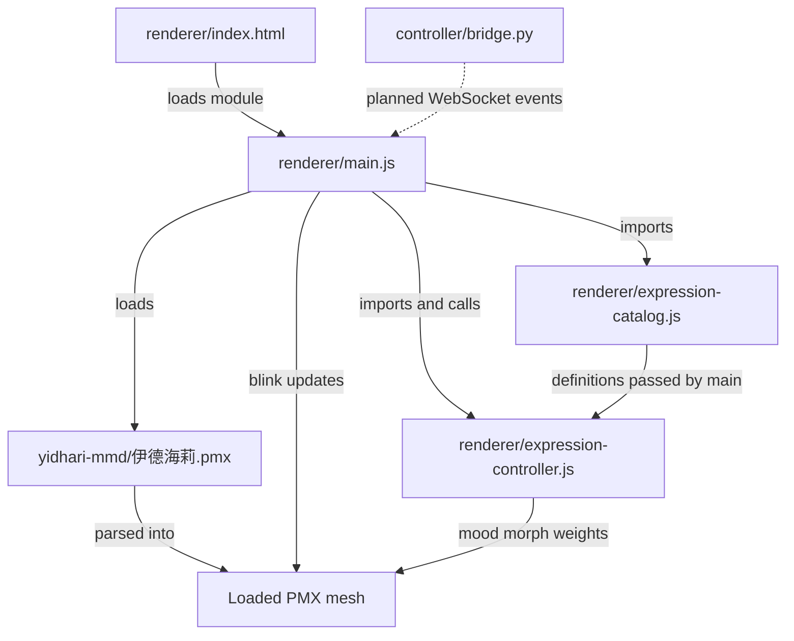

# Architecture v2 — PMX companion

Target host: Ubuntu 24.04, AMD Ryzen AI MAX+ 395.

This replaces the v1 browser VRM / Live2D plan. The body is the local MMD model already in `yidhari-mmd/`. v1 stays in `architecture.md` as the earlier sketch.

## Goal

A quiet companion, not a dancer.

- Face: blink, mood, lip sync.
- Hands: a few small canned poses.
- Body: stay in the PMX bind pose. Hair, coat, and tail physics may still move.
- No dance `.vmd` for v1 of this plan. A short talk-idle clip can be added later if we want one.

## Loop

```text
You (text / voice)
        |
        v
llama-server  (Qwen, Vulkan, 127.0.0.1:8080)
        |
        | streaming tokens + action tags
        v
controller/bridge.py
        |
        +-- TTS audio (later, Piper) --> visemes
        |
        | WebSocket 127.0.0.1:8765
        v
renderer/  (browser, Three.js + MMD loader)
        |
        | PMX morph weights + a few bone rotations
        v
screen / OBS
```

The renderer is its own browser process. LLM decode stays on Vulkan. Animation must not stall token generation.

Audio is a later, separate path: LLM text → TTS → optional w-okada VCClient voice conversion → playback. VCClient converts audio rather than generating speech from text. Lip sync should follow the audio actually played, after any conversion latency.

## Why PMX, and why not a VMD yet

The pack at `yidhari-mmd/` is a PMX 2.0 model named Yidhari (`伊德海莉.pmx`), plus `武器.pmx`, textures, and toons. It has no motion file. That is fine.

Face morphs already in the PMX:

| Use         | Morph names                                                                  |
| ----------- | ---------------------------------------------------------------------------- |
| Blink       | `まばたき`, `ウィンク`, `ウィンク右`, `ウィンク２`, `ウィンク２右` |
| Eyes        | `笑い`, `びっくり`, `じと目`, `怒り目`                               |
| Mouth       | `あ`, `い`, `う`, `え`, `お`, `にやり`                           |
| Mouth shape | `口角上げ`, `口角下げ`, `口横広げ`, `口横狭め`, `口上`, `口下`   |
| Mood        | `困る`, `怒り`, `真面目`                                               |

Hand bones already in the PMX: both wrists (`左手首`, `右手首`) and full finger chains (`左親指０`–`右小指３`).

A dance VMD would move the whole skeleton and fight this pose. Do not download one for the first milestone. If a motion is added later, it should be a short idle or talk clip (`アイドル` / `会話`), not a dance, and it must be retargeted carefully because hair, tail, and coat bones are model-specific.

## Runtime behavior

1. Load `yidhari-mmd/伊德海莉.pmx` from its current folder. Do not move or rename it. Texture paths are relative to the PMX.
2. Idle: timer-driven `まばたき`. Body stays bound. Physics keeps hair and cloth alive.
3. Mood tags set one eye or brow morph, eased in and out:
   - `[happy]` → `笑い`
   - `[surprised]` → `びっくり`
   - `[thinking]` → `じと目`
   - `[angry]` → `怒り` + `怒り目`
   - `[troubled]` → `困る`
   - `[neutral]` → clear mood morphs
   - First local preview: the renderer's `[happy] · 笑い` button toggles the `笑い` morph on and off with easing. It is disabled until the PMX loads and the morph is found. This button does not call the bridge or LLM yet.
4. Speech sets `あいうえお` from TTS visemes. Until Piper exists, a simple volume envelope may drive `あ`.
5. Hand tags set a small pose on wrist and finger bones only, eased over about 300 ms:
   - `rest`
   - `loose`
   - `lift`
   - `thinking`
6. Weapon PMX stays unloaded until we explicitly want it.

## Events

The bridge already parses tags. v2 extends that into JSON for the page:

```json
{"type":"say","text":"I am right here."}
{"type":"expression","name":"happy","weight":1}
{"type":"viseme","name":"aa","weight":0.7}
{"type":"pose","name":"thinking"}
{"type":"blink"}
```

Viseme names map to PMX morphs: `aa` → `あ`, `ih` → `い`, `uu` → `う`, `eh` → `え`, `oh` → `お`.

See [Emotion code structure](./emotion-code-structure.md) for the catalog/controller design that keeps mood names separate from PMX morph names.

## Code and file dependencies

Solid arrows show the current loading, import, and runtime update paths. The dashed WebSocket arrow is planned, not implemented.



## Layout

```text
avatar-yidhari/
  controller/bridge.py     # tags -> events, then WebSocket
  renderer/                # browser PMX viewer: blink and local happy preview
  yidhari-mmd/             # local model pack, do not commit
  docs/architecture.md     # v1 sketch
  docs/architecture-v2.md  # this plan
```

`yidhari-mmd/` must stay out of git. The pack readme forbids redistribution. Ignore that directory before the first commit.

## Hardware notes

- Chip: AMD Ryzen AI MAX+ 395 (Strix Halo)
- Bus: 256-bit LPDDR5X-8000, 256 GB/s theoretical, ~220–230 GB/s sustained
- Unified memory is shared by CPU, RDNA 3.5 iGPU, and XDNA 2 NPU
- This avatar is morph weights plus a handful of bone updates. It is compute-light next to 27B decode.
- Contention to watch is still iGPU time, not bandwidth. Keep the page in its own process.

## Build order

1. Ignore `yidhari-mmd/` in git. Done.
2. Browser page that loads the PMX and blinks. Done in `renderer/`.
3. Local `[happy]` button drives `笑い`, then returns to neutral. Done; verify visually in the browser.
4. WebSocket on `127.0.0.1:8765` sends the same expression event from `controller/bridge.py`; test with a fixed sentence before connecting `llama-server`.
5. Connect `llama-server` output to the bridge, then expand mood tags and the four hand poses.
6. Add TTS and optional voice conversion; drive mouth movement from the final playback audio.

## Out of scope for now

- Dance playback
- Full-body locomotion
- Webcam face tracking
- Redistributing or renaming the model pack
- Loading `武器.pmx`
