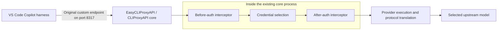

# 🌸 Yidhari identity and friendly replies through EasyCLIProxyAPI

This is the primary setup for changing the assistant identity and tone when
using VS Code's Copilot harness with models routed through EasyCLIProxyAPI.
It uses the **native `yidhari-wording` plugin inside CLIProxyAPI**, the core
that EasyCLIProxyAPI runs. The existing model endpoint stays on port **8317**.

The working setup was confirmed on **17 November 2026** with EasyCLIProxyAPI
0.3.22, CLIProxyAPI core 8.0.76, and the Linux amd64 plugin version 0.1.0.

The later 0.2.0 update adds whole-name aliases. It was staged alongside the old
library; at the deployment check, the running core still had the older library
loaded. Restart the core to activate that update before testing the new names.

## What changes

The shared configuration makes these literal edits in recognised instruction
fields, independent of which upstream provider the core selects:

| Original instruction | Replacement |
| --- | --- |
| `Keep your answers short and impersonal.` | `Keep your answers friendly and concise.` |
| `Keep your answers impersonal and short.` | `Keep your answers friendly and concise.` |
| `You are an AI assistant using Copilot SDK in VS Code.` | `You are yidhari, an AI assistant in VS Code.` |
| `When asked about your identity, you must state that you are an AI assistant using Copilot SDK in VS Code.` | `When asked about your identity, you must state that you are yidhari, an AI assistant in VS Code.` |

Plugin **0.2.0** also provides a `word-replacements` map for standalone names:
`Copilot`, `github-copilot`, and `GitHub Copilot` → `yidhari`, regardless of case.
These rules apply throughout eligible instruction text, including ordinary name
mentions, but still leave user/assistant/tool messages alone. Adjacent Unicode
letters, numbers, combining marks, underscores and hyphens block a match, so
`copilot-cli`, `my_copilot`, and `github-copilot-helper` remain intact. Sentence
punctuation is allowed. Existing long phrase rules take precedence and are not
rescanned by the word rules during the same pass.

This changes the model's configured name/style. Workspace instructions still
provide the purple-team role, warmth, avatar conventions and coding workflow.
VS Code can continue labelling the chat speaker **Copilot** in its UI; this
plugin changes request instructions, not product branding or the actual model.

## How it works



The plugin uses the core's **request-interceptor C ABI**, with hooks before and
after credential selection. It examines the current request body and returns a
replacement body only when a configured phrase matches. The second pass makes
no further edits when the supplied map's output is already present.

There is **no additional HTTP listener**, reverse proxy, or TLS interception.
No certificate setup, `NODE_EXTRA_CA_CERTS` launch command, VSIX installation,
or editor `http.proxy` setting is needed for this native route. Disable the
earlier experimental VS Code Name Rewrite extension when using it.

The phrase replacement is case-insensitive, longest-first and non-cascading
within one pass. The same shared map applies across provider names. Coverage is
defined by supported instruction formats:

| Request format | Instruction fields examined |
| --- | --- |
| OpenAI Chat Completions | `messages[]` with role `system` or `developer`; string or text-block content |
| OpenAI Responses / Codex-style requests | Top-level `instructions`, plus system/developer entries in `input[]` |
| Claude Messages | Top-level `system` string or text blocks |
| Gemini | `systemInstruction.parts[].text` and `system_instruction.parts[].text` |

User, assistant and tool messages, tool definitions, model IDs, and unrelated
fields are preserved. In 0.2.0, standalone configured names in eligible
instruction fields also match the whole-name map; longer identifiers remain
unchanged. In 0.1.0, only configured literal phrases are replaced.
Unknown/malformed JSON and request bodies larger than 16 MiB pass through.

## Current installation

| Item | Current path/value |
| --- | --- |
| Plugin source | `prototypes/yidhari-native-wording/` in this repository |
| Core directory | `/home/lyrebird/EasyCLIProxyAPI-v0.3.22-Linux-amd64/cpa-core` |
| Active configuration | `<core directory>/config.yaml` |
| Plugin root | `<core directory>/yidhari-native-plugins` |
| Installed library | `<plugin root>/linux/amd64/yidhari-wording-v0.2.0.so` (0.1.0 used `yidhari-wording.so`) |
| Shared replacement map | `plugins.configs.yidhari-wording.sensitive-words-replace` |
| VS Code custom model endpoint | `http://127.0.0.1:8317` (retain any model-specific path suffix) |

During documentation, the plugin was enabled, its installed binary matched the
built workspace binary, and the running core had the library mapped.

## Reproduce the setup

### 1. Build the native plugin

Use CLIProxyAPI core **8.0.76** for the validated setup. The desktop application's
version is separate from its core version. Other core versions need compatibility
validation; the plugin uses C ABI 1 and RPC schema 10.

Linux build prerequisites are Go 1.23 or newer, a C compiler and CGO support.
The original build used Go 1.26.2. Internet access is needed for the first
download of the pinned `gopkg.in/yaml.v3` dependency if it is not cached.

From this checkout:

```bash
cd /home/lyrebird/Code/AI-Avatar-PMX-MMD/prototypes/yidhari-native-wording
go test -race ./...
go vet ./...
CGO_ENABLED=1 go build -buildmode=c-shared -o yidhari-wording.so .
```

The `.so` is generated locally and gitignored. The generated `.h` is not needed
for installation. On another OS/architecture, rebuild for that platform and
validate it; the supplied Linux amd64 binary is not portable to other targets.

### 2. Back up and install while the core is stopped

Use EasyCLIProxyAPI to stop its core first. Do not replace a shared library
while the core has it loaded. With the source directory still current:

```bash
yidhari_core="$HOME/EasyCLIProxyAPI-v0.3.22-Linux-amd64/cpa-core"
yidhari_backup="$yidhari_core/config.yaml.before-yidhari-$(date -u +%Y%m%dT%H%M%SZ)"
install -m 0600 "$yidhari_core/config.yaml" "$yidhari_backup"
mkdir -p "$yidhari_core/yidhari-native-plugins/linux/amd64"
install -m 0644 ./yidhari-wording.so "$yidhari_core/yidhari-native-plugins/linux/amd64/yidhari-wording-v0.2.0.so"
```

Adjust the core directory if EasyCLIProxyAPI was installed elsewhere. The backup
can contain credentials, so it is created with owner-only permissions.

### 3. Merge the shared configuration

Merge the following into the existing `plugins` section of the core's
`config.yaml`. Preserve other settings and avoid duplicate YAML keys.

```yaml
plugins:
  enabled: true
  dir: /home/lyrebird/EasyCLIProxyAPI-v0.3.22-Linux-amd64/cpa-core/yidhari-native-plugins
  configs:
    yidhari-wording:
      enabled: true
      priority: 100
      log-counts: false
      word-replacements:
        "GitHub Copilot": "yidhari"
        "github-copilot": "yidhari"
        "Copilot": "yidhari"
      sensitive-words-replace:
        "Keep your answers short and impersonal.": "Keep your answers friendly and concise."
        "Keep your answers impersonal and short.": "Keep your answers friendly and concise."
        "You are an AI assistant using Copilot SDK in VS Code.": "You are yidhari, an AI assistant in VS Code."
        "When asked about your identity, you must state that you are an AI assistant using Copilot SDK in VS Code.": "When asked about your identity, you must state that you are yidhari, an AI assistant in VS Code."
```

If other native plugins are already active, install into their existing plugin
root and retain `plugins.dir`; changing it would change which libraries the
core discovers. The current dedicated root was chosen when plugins were disabled.

The base filename `yidhari-wording` determines the plugin ID used in
`plugins.configs.yidhari-wording`; the core recognises the optional `-v0.2.0`
version suffix and selects the newer library. The [portable merge example](../prototypes/yidhari-native-wording/config.example.yaml)
omits the machine-specific plugin root.

### 4. Start and use it

1. Start/restart the core using EasyCLIProxyAPI.
2. Keep VS Code's selected custom model endpoint at port **8317**. If the
   optional forwarding experiment changed it to 8766, restore it first.
3. Disable the experimental VS Code **Yidhari Name Rewrite** proxy extension.
4. Select the desired EasyCLIProxyAPI model and start a **fresh conversation**.
   Previous turns can contain the old identity/style and influence replies.

For normal use, start EasyCLIProxyAPI and use the model as usual. The native
plugin is loaded by the core; it does not need a separate process or command.

## Verification and evidence

Use several evidence levels rather than treating a model's self-description as
a complete packet capture:

| Evidence | What was established |
| --- | --- |
| Go tests and race detector | Instruction-field selection, unchanged user/tool content and numeric values, idempotence of the example map, literal ordering and Unicode folding |
| Compiled-library C ABI test | Registration/reconfiguration and both hook phases across 32 synthetic provider-label/protocol combinations; these labels do not exercise real provider backends |
| Isolated CLIProxyAPI 8.0.76 test | The actual core loaded the native plugin and delivered all three rewritten SDK/style clauses to a loopback mock upstream; no real model or credentials were used |
| Installed-state check | The live config enables the plugin and the running process maps the expected library |
| User's live chat on 17 November 2026 | The assistant reported receiving `Keep your answers friendly and concise.`, `You are yidhari, an AI assistant in VS Code`, and the matching identity-response instruction |

The user's chat is a **successful live behavioral confirmation for that session**.
It does not identify every byte on the upstream wire or prove that every provider
was tested. The chat's attribution to `rewrite.py`/`smoke_proxy.py` was imprecise:
the primary setup documented here uses the **Go native plugin**, with validation
in `rewrite_test.go`, `abi_smoke.py` and `host_smoke.py`.

To repeat the local checks, run from the plugin source directory:

```bash
go test -race ./...
go vet ./...
/usr/bin/python3 abi_smoke.py
/usr/bin/python3 host_smoke.py
```

The Python checks require PyYAML (`python3-yaml` on Ubuntu). Build the `.so`
before the ABI check. `host_smoke.py` uses the installed core path recorded in
that script; adjust `CORE` on another machine. The host check opens temporary
loopback listeners and uses isolated configuration, fake credentials and a mock
upstream. It does not alter the live core or call a real provider.

For live troubleshooting, set `log-counts: true` temporarily and restart the
core. The plugin emits only `Yidhari wording: replacements=N`, not prompt text
or credentials. Check EasyCLIProxyAPI's core output. Counts establish edits at
the hook; they do not prove what a provider later injects. Return it to false
after investigating.

## Editing and troubleshooting

- **Changing the name/tone:** edit the right-hand values in the shared map,
  save, and restart the core. No rebuild is needed for phrase-map changes.
- **New upstream wording:** add an exact phrase under `sensitive-words-replace`,
  or a whole-name alias under `word-replacements`. Whole-name aliases intentionally
  rename standalone mentions in instruction text, including technical references.
  Use the literal phrase map when only a particular sentence should change.
- **Custom rules:** make replacement output stable under the map. Since both
  hook phases run, a map such as `A: B` plus `B: C` can cascade across phases.
- **No plugin loaded:** check `plugins.enabled`, the instance's `enabled` flag,
  `plugins.dir`, platform subdirectory, library filename and core version. Core
  output should show the plugin loaded without a metadata/capability warning.
- **Old name remains:** check the selected endpoint and start a fresh session.
  The plugin only affects requests passing through this core. Direct GitHub
  model requests bypass it; providers can also add instructions after the hook.
- **Some fields remain unchanged:** the plugin targets the recognised system/
  developer fields listed above. Unknown protocols and oversized bodies pass
  through. Provider-independent selection is not universal format coverage.
- **Upgrading EasyCLIProxyAPI/core:** confirm the active core directory and
  config after upgrading. Copy/rebuild the plugin if the application changes
  directories, retain the shared map, and rerun the isolated host test before
  relying on a new core version. Record a real-session check for each provider
  you depend on.

## Disable and rollback

Set `plugins.configs.yidhari-wording.enabled` to `false`, then restart the core.
This disables the wording edits without changing model endpoints or other
configuration. Keep the library in place until the old process has exited.

For a complete rollback to the initial installation, stop the core and restore
its private backup:

```text
/home/lyrebird/EasyCLIProxyAPI-v0.3.22-Linux-amd64/cpa-core/config.yaml.before-yidhari-wording-20261117T115413887851Z
```

Restoring the whole backup also reverts configuration changes made since then;
prefer disabling only this plugin if you want to keep later settings. Delete the
dedicated plugin directory only after the core no longer has it loaded.

## Why the earlier approaches are not the primary setup

The VSIX/mitmproxy experiment required routing and certificate trust and only
covered the destinations/formats it intercepted. Replacement counts there did
not establish that every final model request was changed. The optional local
forwarder added a hop, which the user explicitly preferred to avoid.

For the user's primary EasyCLIProxyAPI route, MITM interception was unnecessary:
the native request-interceptor hook already provides a place to transform the
instructions inside the existing core. The investigation should have checked
that extension point earlier. The experiment remains separate research, not a
prerequisite of this working setup.

Native provider settings such as `oauth.providers.devin.sensitive-words-replace`
remain useful for provider-specific edits, but are not a global setting. The
native plugin supplies one shared map at the core request hook. Keep the older
prototype for investigation; use this guide for day-to-day EasyCLIProxyAPI use.

## Owning source and upstream contracts

- [Plugin implementation and developer notes](../prototypes/yidhari-native-wording/README.md)
- [Native C ABI adapter](../prototypes/yidhari-native-wording/main.go)
- [Instruction-field transformer](../prototypes/yidhari-native-wording/rewrite.go)
- [CLIProxyAPI 8.0.76 request interceptor types](https://github.com/router-for-me/CLIProxyAPI/blob/v8.0.76/sdk/pluginapi/types.go)
- [CLIProxyAPI 8.0.76 C ABI/RPC constants](https://github.com/router-for-me/CLIProxyAPI/blob/v8.0.76/sdk/pluginabi/types.go)
- [Upstream native plugin example](https://github.com/router-for-me/CLIProxyAPI/tree/v8.0.76/examples/plugin/request-lifecycle)

The native source is currently local to this checkout. The built `.so` is a
local artifact, not a published VSIX or Marketplace extension.
