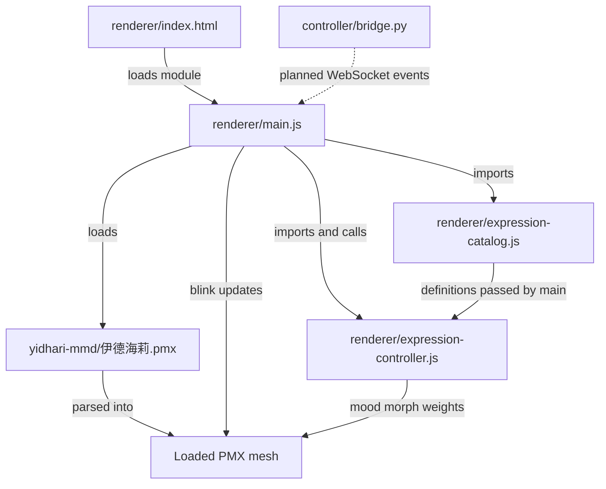

# Emotion code structure

This is the implementation plan for facial moods in the PMX companion. Local `[happy]` and `[surprised]` previews use the same controller; neither is connected to the bridge yet.

## Responsibilities

- `renderer/expression-catalog.js` maps semantic mood names to PMX morph names and relative weights. It currently defines `happy` → `笑い` and `surprised` → `びっくり`. `neutral` is a controller action, not a PMX morph.
- `renderer/expression-controller.js` resolves those names against the loaded model, reports missing morphs, stores one active mood, and eases its morph weights each frame. Selecting another mood fades the old one out.
- `renderer/main.js` loads and renders the model. Its preview buttons call the controller; future WebSocket messages must call the same `setExpression` method rather than implement a second animation path.
- `controller/bridge.py` will eventually convert LLM tags into semantic expression events. It should not know PMX names or write morph weights. No bridge-to-renderer transport exists yet.

## Code and file dependencies

Solid arrows show the current loading, import, and runtime update paths. The dashed WebSocket arrow is planned, not implemented.

## Channel boundaries

Mood is exclusive: one named mood at a time, or neutral. Idle blink remains independent, as do future speech visemes and hand poses. Each channel should own its own morphs or bones. If two channels influence the same facial area, preview the combination on this PMX and define a blending rule before enabling both together. In particular, test `笑い` with `まばたき` visually.

## Adding an expression

1. Preview the candidate morph on the loaded PMX and confirm its visual meaning.
2. Add one semantic entry to the catalog, with one or more PMX morph weights. Keep implementation-specific names out of bridge events.
3. The controller will resolve every required morph. If any is missing, it marks that expression unavailable; the UI should disable its preview control and show the missing name.
4. Route a local preview control and, later, a bridge event through `setExpression(name, weight)`.
5. Verify transitions from neutral, from another mood, and back to neutral. Check interaction with blink and speech as those channels arrive.

The next integration milestone after these local previews is the planned localhost WebSocket, tested with a fixed sentence before connecting `llama-server`.
