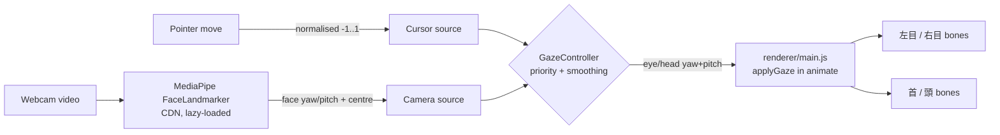

# 👁️ Gaze tracking — design (issue #6)

> Add facial/eye tracking to the camera: Yidhari's eyes (and, gently, her
> head) follow your mouse cursor and/or your face on webcam.

## 🌸 User-facing behaviour

- Two independent toggles live in **Independent channels**, next to
  Auto-blink:
  - **Cursor tracking** — her gaze follows the mouse pointer over the page.
  - **Camera tracking** — her gaze follows your face via the webcam.
- Either, both, or neither may be on. When **both** are on, camera
  (where *you* are looking, approximated by face position/pose) wins while
  a face is visible; the cursor takes over the moment the face is lost.
  This priority is deterministic and unit-tested.
- When no source is active (toggles off, pointer off-window, or no face),
  the gaze eases back to centre instead of snapping.
- Eyes lead, head follows: eye bones rotate most of the way, `首` (neck)
  and `頭` (head) rotate a smaller fraction, so it reads as alive rather
  than a turret. Blink, wink, mood, speech and audition morphs are
  untouched — gaze is a *bone* channel, layered like `restArms()`.

## 🧭 Why bones, not morphs

Verified in `docs/pmx-morph-catalog.md`: the PMX eye panel has **no**
gaze-direction morphs (only blink/wink/open/angry/half-close…). The PMX
does provide the standard MMD eye bones `左目` / `右目` (and `両目`, `頭`,
`首`), so gaze = rotating those bones, clamped to a comfortable range.

## 🔬 Architecture

- `renderer/gaze-tracking.js` — **pure logic, no DOM/Three.js imports.**
  Normalisation, clamping, exponential smoothing, source arbitration,
  and the mapping from normalised target → eye/head angles. This is the
  unit-tested core (`tests/renderer/gaze-tracking.test.mjs`), following
  the `speech-session.js` pattern.
- `renderer/camera-gaze.js` — browser-only adapter: requests the webcam
  (only when the toggle is switched on), lazy-loads MediaPipe
  FaceLandmarker from CDN, reduces landmarks to a normalised gaze
  target, and releases the camera stream when toggled off.
- `renderer/main.js` — wiring only: pointer listener, toggles, and
  `applyGaze(delta)` inside `animate()`, composing gaze quaternions on
  top of each bone's captured rest quaternion.

## 🛡️ Privacy & safety

- The webcam is **never** started at page load — only on an explicit
  toggle click (`getUserMedia` user gesture). Frames are processed
  locally in the browser; nothing is recorded, stored, or sent anywhere.
- Toggling camera off stops all media tracks immediately.
- If permission is denied, the model fails to load, or no eye bones
  exist, gaze degrades silently to centre and the toggle reports why.
- Eye angles are clamped to ±0.38 rad yaw, 0.12 rad upward and 0.22 rad
  downward pitch. The final pitch is clamped again **after** adding the thinking
  offset, so cursor/camera tracking and the mood cannot stack into an eye roll.
  Head/neck keep their existing range (45% of the original ±0.22 rad vertical
  target), independently of this eye-only cap.

## 🧪 Testing

- `node --test tests/renderer/gaze-tracking.test.mjs` — pure-logic tests:
  centre is neutral, extremes and combined thinking offsets clamp, both input
  sources respect the upward eye cap, head range is preserved, smoothing
  converges without overshoot, camera-over-cursor priority, and stale-source
  fallback to centre.
- Webcam + visual bone motion are manual checks (no camera in CI):
  toggle each source, move cursor / face, confirm eyes lead and head
  follows, and that OrbitControls drag still works while tracking.

## 🔭 Follow-ups (not in this change)

- True eye-in-head gaze from iris landmarks; blink on detected user blink.
- Saccades / micro-drift so a still cursor does not mean a frozen stare.
- OBS/browser-source packaging of the camera mode.
