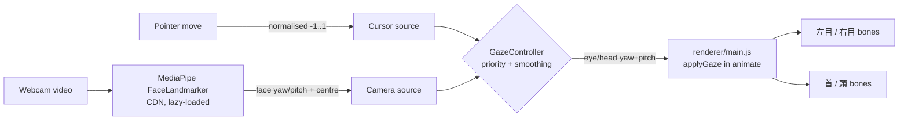

# 👁️ Gaze tracking — design (issue #6)

> Add facial/eye tracking to the camera: Yidhari's eyes (and, gently, her
> head) follow your mouse cursor and/or your face on webcam.

## 🌸 User-facing behaviour

- Two independent toggles live in **Independent channels**, next to
  Auto-blink:
  - **Cursor tracking** — her gaze follows the mouse pointer over the page.
  - **Camera tracking** — her gaze follows your face via the webcam.
- **Tracking camera** (#53), below the camera toggle, lists the available
  webcams. Choose a device or **System default camera**, then enable tracking.
  Changing the selection while tracking releases the previous camera before
  opening the new one, without reloading. **Refresh** updates the device list
  without opening a camera; supported browsers also refresh on `devicechange`.
- The browser may hide device names or non-default cameras before permission
  is granted. Unnamed inputs use numbered labels; enable tracking to request
  permission, then the list refreshes with readable names. An empty list does
  not disable the opt-in toggle, since the browser may be filtering the list.
- The preferred device ID is saved in local storage (`yidhari.cameraDevice`)
  where available. Capture always starts **off**, including after a reload.
  Blocked storage still allows a session-only choice. Browser permissions,
  clearing site data, or changing browsers may invalidate a remembered ID.
- A saved device missing from the list stays explicit as **Saved camera (not
  listed)**; there is no silent fallback to a different camera. It may be
  disconnected or hidden by permission. Choose another camera/default, or
  enable tracking to try the saved one. Busy, missing, denied and disconnected
  cameras show recovery instructions. Disconnection switches tracking off;
  reconnecting does not automatically restart capture.
- Either, both, or neither may be on. When **both** are on, camera
  (where *you* are looking, approximated by face position/pose) wins while
  a face is visible; the cursor takes over the moment the face is lost.
  This priority is deterministic and unit-tested.
- When no source is active (toggles off, pointer off-window, or no face),
  the gaze eases back to centre instead of snapping.
- Eyes lead, head follows: eye bones rotate most of the way, `首` (neck)
  and `頭` (head) rotate a smaller fraction, so it reads as alive rather
  than a turret. Blink, wink, mood, speech and audition morphs are
  untouched — gaze is a *bone* channel, layered like `restArms()`.

## 🧭 Why bones, not morphs

Verified in `docs/pmx-morph-catalog.md`: the PMX eye panel has **no**
gaze-direction morphs (only blink/wink/open/angry/half-close…). The PMX
does provide the standard MMD eye bones `左目` / `右目` (and `両目`, `頭`,
`首`), so gaze = rotating those bones, clamped to a comfortable range.

## 🔬 Architecture

- `renderer/gaze-tracking.js` — **pure logic, no DOM/Three.js imports.**
  Normalisation, clamping, critically damped smoothing (eases in and out,
  and keeps its speed when the target moves), source arbitration,
  and the mapping from normalised target → eye/head angles. This is the
  unit-tested core (`tests/renderer/gaze-tracking.test.mjs`), following
  the `speech-session.js` pattern.
- `renderer/camera-gaze.js` — browser-only adapter: requests the webcam
  on explicit opt-in (or a device change while already opted in), lazy-loads MediaPipe
  FaceLandmarker from CDN, reduces landmarks to a normalised gaze
  target, and releases the camera stream when toggled off. A selected device
  uses an exact `deviceId` constraint. Generation checks after asynchronous
  startup steps discard late streams and prevent cancelled requests from
  reviving detection or stopping a newer camera. Tracker loading is shared
  across switches and retried after a download failure. The frame source
  follows the existing pop-out window through camera switches.
- `renderer/camera-controls.js` — device enumeration, safe text labels,
  preference storage, toggle/selector state, disconnection and error recovery.
  It never requests capture just to discover cameras or restore a choice.
- `renderer/main.js` — wiring only: pointer listener, toggles, and
  `applyGaze(delta)` inside `animate()`, composing gaze quaternions on
  top of each bone's captured rest quaternion.

## 🛡️ Privacy & safety

- The webcam is **never** started at page load — only on an explicit
  toggle click (`getUserMedia` user gesture). Frames are processed
  locally in the browser; nothing is recorded, stored, or sent anywhere.
- Toggling camera off, switching devices, or leaving the page stops acquired
  media tracks. If a pending permission prompt later returns a stream after
  cancellation, that stream is immediately stopped without starting detection.
- If permission is denied, the model fails to load, or no eye bones
  exist, gaze degrades silently to centre and the toggle reports why.
- Eye angles are clamped to ±0.38 rad yaw, 0.12 rad upward and 0.22 rad
  downward pitch. The final pitch is clamped again **after** adding the thinking
  offset, so cursor/camera tracking and the mood cannot stack into an eye roll.
  Head/neck keep their existing range (45% of the original ±0.22 rad vertical
  target), independently of this eye-only cap.

## 🧪 Testing

- `node --test --test-isolation=none tests/renderer/camera-gaze.test.mjs tests/renderer/camera-controls.test.mjs`
  covers selected/default constraints, release-before-switch, out-of-order
  requests, cancellation during capture/video/tracker startup, tracker retry,
  floating-window frame scheduling, disconnection, error recovery, permission
  filtering, enumeration refresh, preference restoration and blocked storage.
- Validation for #53 on 14 November 2026: all 38 new behaviour tests passed.
  The initial adapter red run had 11 failures out of 15 tests, including missing
  device constraints, late-stream leaks, switching and error classification.
  Two additional compatibility tests reproduced a disabled default selector
  without enumeration and an overwritten unsupported-browser hint before fixes.
- An isolated headless Chrome check used the real page markup/styles and camera
  modules, canvas-backed native `MediaStream`/video playback, synthetic device
  enumeration and a mocked tracker. It verified live switching and old tracks
  ending, reload without capture, busy/denied recovery, delayed startup cleanup,
  disconnect handling, and panel fit with no page errors. The live bridge and
  avatar were not loaded. Local screenshot: `assets/private/issue-53/camera-controls.png`
  (gitignored). Physical webcams and the real MediaPipe model were **not**
  exercised by this check.
- `node --test tests/renderer/gaze-tracking.test.mjs` — pure-logic tests:
  centre is neutral, extremes and combined thinking offsets clamp, both input
  sources respect the upward eye cap, head range is preserved, smoothing
  converges without overshoot, camera-over-cursor priority, and stale-source
  fallback to centre.
- Webcam + visual bone motion are manual checks (no camera in CI):
  toggle each source, move cursor / face, confirm eyes lead and head
  follows, and that OrbitControls drag still works while tracking.
- Hardware acceptance for #53: connect two cameras, choose each while off
  (capture indicators stay off), then enable and switch while tracking. Confirm
  the previous camera releases and gaze follows the new source without reload.
  Reload (preference retained, capture off), deny permission, occupy a camera
  in another app, and unplug/replug the active/saved device. Confirm actionable
  status, manual recovery and no automatic restart. Repeat with the avatar
  popped out. These physical-device checks remain pending.

Browser API references: [device enumeration and permission filtering](https://developer.mozilla.org/en-US/docs/Web/API/MediaDevices/enumerateDevices),
[exact device constraints](https://developer.mozilla.org/en-US/docs/Web/API/MediaTrackConstraints/deviceId),
and [capture errors and releasing tracks](https://developer.mozilla.org/en-US/docs/Web/API/MediaDevices/getUserMedia).

## 🔭 Follow-ups (not in this change)

- True eye-in-head gaze from iris landmarks; blink on detected user blink.
- Saccades / micro-drift so a still cursor does not mean a frozen stare.
- OBS/browser-source packaging of the camera mode.
