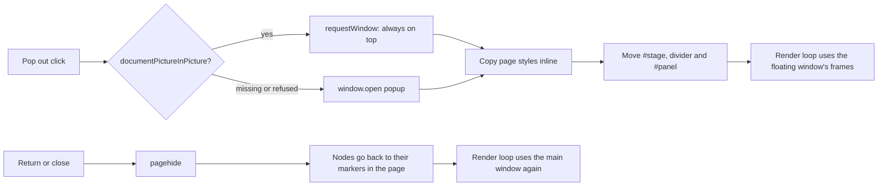

# 📌 Pop-out floating window (issue #52)

> Keep Yidhari visible above your editor, browser or terminal, like a
> picture-in-picture video, without switching back to the renderer tab.

## 🌸 Using it

1. Open the renderer as usual (`http://127.0.0.1:8770/renderer/`).
2. Click **📌 Pop out** (Chrome / Edge) or **🪟 Pop out (window)**
   (Firefox and other browsers) next to **Face** / **Bust**.
3. A small floating window opens with her portrait in it. Drag its title
   bar to move it and drag its edges to resize it; the portrait follows the
   new size. The main page says she is popped out.
4. Click **💬** in the floating window's top-right corner to show the chat
   bar, the chat log and the settings panel on the right, just like the main
   page. The window widens to make room; click **💬** again to go back to the
   portrait alone. The choice is remembered for the next pop-out.
5. To bring her back, click **↩** in the floating window, click
   **↩ Return** in the main page, or close the floating window. Everything
   returns to the main page exactly where it was.

Drag to orbit and scroll to zoom work inside the floating window, and cursor
gaze follows the pointer over it.

## 🧭 How it works



- Chrome and Edge use the
  [Document Picture-in-Picture API](https://developer.chrome.com/docs/web-platform/document-picture-in-picture).
  Elsewhere, or when that API refuses to open a window (Electron-based
  browsers report "no window"), an ordinary popup from `window.open()` is
  used instead. Both belong to the **same page**: the portrait, chat bar,
  divider and settings panel are moved into the window, not copied, and no
  second renderer starts.
- Because nothing reconnects, the bridge WebSocket, the agent MCP routing
  (`say`, `report`, `ask`, `set_mood` go to the page that owns agent
  speech), the speech AudioContext, lip sync and moods carry on
  unchanged. Closing the floating window never closes the bridge.
- Opening a second renderer tab instead would make a second bridge
  connection. It would compete for agent speech with the first (see
  [Which page owns agent speech](agent-voice.md#which-page-owns-agent-speech)) and load
  the PMX twice, which is why that route was not taken.
- The page's style rules are copied into the floating window inline (a
  `<link>` only for sheets whose rules cannot be read), so the very first
  resize measures a styled canvas. `resize()` never writes an inline CSS
  size on the canvas; the stylesheet sizes it in both windows.
- Code that measures the window (the panel divider, the chat box's resize
  and float limits) asks the document the element currently lives in, not
  the main page, so it works in either window.
- Browsers pause `requestAnimationFrame` in hidden or minimised tabs. While
  she is popped out, the render loop (and webcam gaze, if on) runs on the
  floating window's frames, so she keeps moving when the main tab is hidden.
- Closing the main page closes a popup window too; a picture-in-picture
  window closes with its page by itself.
- Code: `renderer/pop-out.js` (`PopOut` moves the nodes and restores them on
  `pagehide`, `popupWindow` is the `window.open()` fallback, `FrameLoop` lets
  the frame source change between windows), wired up in `renderer/main.js`.
  Tests: `tests/renderer/pop-out.test.mjs`.

## 🖥️ Supported platforms

| Browser | Pop out | Stays on top |
| --- | --- | --- |
| Chrome / Chromium / Edge 116+ (desktop) | ✅ Picture-in-picture window | ✅ On X11 by itself; 📌 on Wayland pin it (below) |
| Firefox | ✅ Popup window | 📌 Pin it with the window manager |
| VS Code's built-in browser | ✅ Popup window | 📌 Pin it with the window manager |
| Other Electron hosts (the Claude app's browser pane) | ⚠️ Only if the host allows `window.open()`; otherwise the status line explains why | 📌 Window manager, if it opens |
| Mobile browsers | ❌ Not available | — |

Verified on 8 November 2026 on the project machine (Ubuntu 24.04, GNOME 46,
Wayland session): the picture-in-picture window in Chrome and the popup
window in Firefox and VS Code's browser all open, follow resizing and
return. Under Wayland none of them stays on top by itself; **Super+T**
(set up below) pins each of them.

The page must be opened from `http://127.0.0.1:8770`, and the window can
only be opened from a click; browsers refuse it otherwise. If Firefox blocks
the popup, allow pop-ups for `127.0.0.1:8770` (the icon at the left of the
address bar) and click again.

## 📌 Keeping the floating window on top

A web page cannot keep an ordinary window above other windows, and under
Wayland not even a picture-in-picture window can place itself there. Ask the
window manager instead:

- **Ubuntu / GNOME, with a shortcut (verified):** GNOME's
  *Toggle window always appearing on top* action has no key by default. Bind
  it to Super+T (unused by default on Ubuntu 24.04) once:

  ```bash
  gsettings set org.gnome.desktop.wm.keybindings toggle-above "['<Super>t']"
  ```

  Then click the floating window and press **Super+T** to pin it; press it
  again to unpin. It works for any window, in X11 and Wayland sessions. To
  remove the shortcut again:

  ```bash
  gsettings reset org.gnome.desktop.wm.keybindings toggle-above
  ```

- **GNOME, without a shortcut:** with the floating window focused, press
  Alt+Space (or right-click its title bar) and tick **Always on Top**.
- **KDE Plasma:** right-click the title bar → **More Actions** → **Keep
  Above Others**.
- **Windows:** no built-in option; PowerToys' Always on Top (Win+Ctrl+T)
  works.
- **macOS:** no built-in option.

## ⚠️ Operating-system and window-manager limits

- **The page has no pin switch.** Browsers offer web pages no way to set or
  clear always-on-top. Where picture-in-picture stays on top by itself
  (X11), it cannot be unpinned; everywhere else the window manager's
  shortcut both pins and unpins. The page's own toggle is
  **Pop out ↔ Return**.
- **One floating window at a time.** The page never asks for a second one.
- **Size and position:** the page asks for 360 × 480 for the portrait
  alone, and wider and taller with the side panel. The browser chooses where
  it opens and may clamp the size. Showing or hiding the panel resizes the
  window when the browser allows it; otherwise drag its edge.
- **Linux, X11:** the window manager is asked to keep a picture-in-picture
  window above others; GNOME and KDE on X11 honour this.
- **Linux, Wayland (Ubuntu 24.04 GNOME default):** the Wayland protocol does
  not let applications place their own windows above others. Chrome's
  default native-Wayland backend opens the picture-in-picture window as an
  ordinary window (seen on GNOME 46), so pin it with **Super+T** or
  **Always on Top** as above. Running Chrome on XWayland
  (`--ozone-platform=x11`, or `chrome://flags/#ozone-platform-hint` set to
  X11) should let it pin itself as on X11, at the cost of some native
  Wayland features; this was not tested.
- **Full-screen applications:** a full-screen window (a video player, a game
  or an editor in full-screen mode) may cover the floating window; this
  depends on the window manager and is not guaranteed by the browser. Use a
  maximised window instead of full screen if you want her in view.
- **Closing the main tab** closes the floating window with it.

## 🔬 Manual check

1. Start `serve.py` and the bridge with `--agent` from the same checkout,
   open the renderer and wait for **Connected · ready**.
2. Click the pop-out button: she appears in a floating window and the main
   page says she is popped out.
3. Focus another application and drag it over the floating window: she
   stays on top (picture-in-picture), or stays on top once pinned (popup).
4. Resize and move the floating window: the portrait keeps its aspect and
   stays sharp.
5. Click **💬**: the chat bar and the settings panel appear on the right.
   Send a chat message, drag the divider, and float the chat box. Click
   **💬** again: only the portrait remains.
6. From the agent, call `set_mood`, `say` and `report`: the face changes,
   she speaks with lip sync, and the chat log updates.
7. Minimise the main browser window: she keeps blinking and swaying.
8. Close the floating window: everything is back in the main page, and the
   bridge status still says connected.
