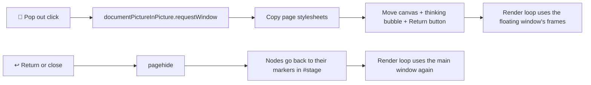

# 📌 Pop-out floating window (issue #52)

> Keep Yidhari visible above your editor, browser or terminal, like a
> picture-in-picture video, without switching back to the renderer tab.

## 🌸 Using it

1. Open the renderer as usual (`http://127.0.0.1:8770/renderer/`).
2. Click **📌 Pop out** next to **Face** / **Bust** under her portrait.
3. A small floating window opens with her portrait in it. It stays above
   ordinary application windows. Drag its title bar to move it and drag its
   edges to resize it; the portrait follows the new size.
4. To bring her back, either click **↩ Return** inside the floating window,
   click **↩ Return** in the main page, or close the floating window. She
   reappears in the main page exactly where she was.

Drag to orbit and scroll to zoom still work inside the floating window, and
cursor gaze follows the pointer over it. Chat, the test bench and the camera
framing buttons stay in the main page.

## 🧭 How it works

- It uses the browser's
  [Document Picture-in-Picture API](https://developer.chrome.com/docs/web-platform/document-picture-in-picture).
  The floating window belongs to the **same page**: the WebGL canvas element
  is moved into it, not copied, and no second renderer starts.
- Because nothing reconnects, the bridge WebSocket, the agent MCP routing
  (`say`, `report`, `ask`, `set_mood` go to the newest renderer
  connection), the speech AudioContext, lip sync and moods carry on
  unchanged. Closing the floating window never closes the bridge.
- Opening a second renderer tab or a `window.open` popup instead would make
  a second bridge connection. That one would take agent speech away from
  the first and load the PMX twice, which is why that route was not taken.
- Browsers pause `requestAnimationFrame` in hidden or minimised tabs. While
  she is popped out, the render loop (and webcam gaze, if on) runs on the
  floating window's frames, so she keeps moving when the main tab is hidden.
- Code: `renderer/pop-out.js` (`PopOut` moves the nodes and restores them on
  `pagehide`; `FrameLoop` lets the frame source change between windows),
  wired up in `renderer/main.js`. Tests: `tests/renderer/pop-out.test.mjs`.

## 🖥️ Supported platforms

| Browser | Pop out |
| --- | --- |
| Chrome / Chromium / Edge 116+ (desktop) | ✅ Supported |
| Firefox, Safari | ❌ No Document Picture-in-Picture; the button is disabled and says why |
| Mobile browsers | ❌ Not available |

The page must be opened from `http://127.0.0.1:8770` (a secure context),
and the window can only be opened from a click; the browser refuses it
otherwise.

## ⚠️ Operating-system and window-manager limits

- **Always on top cannot be switched off.** The browser always keeps a
  picture-in-picture window above other windows and offers no pin switch to
  web pages. The toggle is therefore **📌 Pop out ↔ ↩ Return**. A true pin
  switch on an ordinary window would need a native shell such as pywebview
  or Tauri, which is out of scope.
- **One floating window at a time.** Chrome keeps one picture-in-picture
  window open; the page also never asks for a second one.
- **Size and position:** the page asks for 360 × 480; the browser chooses
  where it opens and may clamp the size to its own minimum and maximum.
- **Linux, X11:** the window manager is asked to keep the window above
  others; GNOME and KDE on X11 honour this.
- **Linux, Wayland (Ubuntu 24.04 GNOME default):** the Wayland protocol does
  not let applications place their own windows above others. Whether the
  floating window stays on top depends on Chrome's backend: Chrome on
  XWayland should behave as on X11, while native-Wayland Chrome may open it
  as an ordinary window. If it does not stay on top, right-click its title bar
  (or press Alt+Space) and choose GNOME's **Always on Top**, or run Chrome
  with `--ozone-platform=x11`.
- **Full-screen applications:** a full-screen window (a video player, a game
  or an editor in full-screen mode) may cover the floating window; this
  depends on the window manager and is not guaranteed by the browser. Use a
  maximised window instead of full screen if you want her in view.
- **Closing the main tab** closes the floating window with it, because the
  floating window belongs to that page.

## 🔬 Manual check

1. Start `serve.py` and the bridge with `--agent`, open the renderer and
   wait for **Connected · ready**.
2. Click **📌 Pop out**: she appears in a floating window and the main stage
   says she is popped out.
3. Focus another application and drag it over the floating window: she
   stays on top (see the Wayland note above).
4. Resize and move the floating window: the portrait keeps its aspect and
   stays sharp.
5. From the agent, call `set_mood`, `say` and `report`: the face changes,
   she speaks with lip sync, and the chat log in the main page updates.
6. Minimise the main browser window: she keeps blinking and swaying.
7. Close the floating window: she is back in the main page, and the bridge
   status still says connected.
